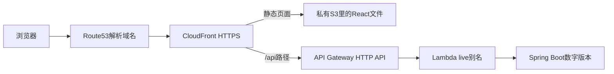
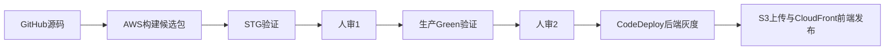

# kongPortfolio AWS 学习手册

更新：2026-11-12。学习起点：React + Spring Boot代码已经在GitHub，本项目还没有部署到AWS。IAM/SSO的建立过程略过，直接使用你会配置的kong-dev登录。

这是一份按首次搭建顺序重新编排的学习文档。与按发生时间记账的[AWS_EXECUTION_LOG.md](AWS_EXECUTION_LOG.md)不同，这里从第1步开始教你理解和操作。每步区分“人亲手做什么”和“脚本/AWS替你做什么”，保留实际结果和故障。

**使用范围：** 以下搭建过程已经做完，用于学习，不要对现在的环境从头重复创建。<...>要替换；旧计划不能复用。实际起点已有IAM、两个预算和一个旧Route53托管区，所以“从零”指本项目的State、网站、CI/CD尚未建立，不假装当时AWS账号里什么都没有。

## 先看两条路线

访问网站时：



Route53负责DNS解析，HTTP内容本身由CloudFront等服务处理，不经过Route53转发。

发布代码时：



| 工具 | 你在哪里使用 | 负责什么 |
|---|---|---|
| Git命令 | 本机PowerShell | 提交、上传代码、确定源码版本 |
| 文件编辑器 | 本机仓库 | 写.tf、Java、TypeScript、脚本和buildspec |
| Terraform | 本机PowerShell | 声明/创建/更新AWS资源及其配置 |
| AWS CLI | 本机或CodeBuild内部 | 直接调用AWS API，查状态、上传包、启动流程 |
| PowerShell/Node脚本 | 本机或CodeBuild内部 | 把校验和多条命令按顺序串起来 |
| 浏览器控制台 | AWS、GitHub | 授权连接、人工审批、查看资源和日志 |
| CodeBuild | AWS临时构建环境 | 运行测试、打包及发布脚本 |
| CodePipeline | AWS | 安排阶段、传递制品、等待审批 |
| CodeDeploy | AWS | 调整Lambda别名权重并执行回滚 |

Terraform和AWS CLI最终都在调用AWS API；脚本是组织操作的方式。看到一条.ps1或.mjs命令，不代表里面没有Terraform/AWS CLI。

## 第1步：确认起点与本机工具

**为什么先做：** 避免用错目录、分支、AWS账号。GitHub有代码，只代表源码存好了，不代表网站已经上线。

**方式：本机PowerShell、Git、AWS CLI。** 后续未特别注明时，工作目录都是仓库根目录。

```powershell
Set-Location D:\study\kongPortfolio
$aws = 'D:\software\AWSCLI\aws.exe'
$tf = 'D:\software\Terraform\terraform.exe'
$env:AWS_PROFILE = 'kong-dev'
. ./scripts/tools.ps1
git status --short
git remote -v
& $aws sts get-caller-identity --query '{Account:Account}' --output json
```

| 命令/语法 | 作用 |
|---|---|
| Set-Location | 切到项目目录，避免在terraform-test里改项目 |
| $aws、$tf | 保存本机程序完整路径；不是AWS密码 |
| & $aws / & $tf | PowerShell调用变量中的可执行程序 |
| AWS_PROFILE | 本终端后续AWS/TF使用kong-dev凭证 |
| . ./scripts/tools.ps1 | 在当前终端加载工具PATH/JAVA_HOME和检查函数 |
| git status --short | 看本地是否有未提交文件 |
| git remote -v | 确认origin确实是本项目GitHub仓库 |
| sts get-caller-identity | 只读确认实际AWS账号，预期561798268037 |

如果CLI登录过期，执行 `& $aws sso login --profile kong-dev`，在浏览器完成SSO认证，然后重查STS。只登录AWS网页不一定更新CLI凭证。

**实际发生：** 你最早在D:\software\terraform-test跑init/plan，成功读出账号。当时只有output变化，没创建资源；后续正式目录移到本仓库。

**完成标准：** 仓库/账号正确，CLI认证有效。

## 第2步：先设置Git安全边界

**理由：** State、变量、计划、联系人资料会陆续出现，不能等上传GitHub后才想起排除它们。

**方式：文件编辑器 + 本机Git/Node/Gitleaks。** 对应.gitignore、.githooks/、scripts/install-hooks.ps1。

```powershell
./scripts/install-hooks.ps1
node .githooks/check-staged-paths.mjs --all
gitleaks dir . --redact --no-banner
git diff --check
```

| 命令 | 作用 |
|---|---|
| install-hooks.ps1 | 内部git config core.hooksPath .githooks，让本仓库使用检查钩子 |
| check-staged-paths --all | 检查已跟踪文件中有没有禁止发布的私有路径 |
| gitleaks dir | 扫描工作区疑似秘密；redact隐藏匹配值 |
| git diff --check | 查空白格式错误 |

允许提交：公开源码、.tf、.example模板、.terraform.lock.hcl。
不提交：.env、密钥/证书、.terraform/、State、plan、terraform.tfvars、backend.hcl、.local/。

**实际发生：** 配置了缺少Gitleaks就拒绝提交的钩子；后来还补测Git文件执行权限，解决Windows正常但Linux构建失败的问题。

**完成标准：** 私有路径被忽略，扫描通过，提交/推送会执行钩子。

## 第3步：写Terraform基础配置，弄懂四类文件

**理由：** Terraform要知道“去哪个账号、哪个区域、创建什么、状态存哪里”。

**方式：文件编辑器。** 首先写infra/terraform/bootstrap/，不是去控制台逐个建S3配置。

| 文件 | 内容/目的 |
|---|---|
| main.tf | Provider、变量、S3资源、账号限制 |
| terraform.tfvars.example | 公开输入示例，不放秘密 |
| terraform.tfvars | 本机真实输入，被忽略 |
| backend.hcl | 远程State位置/锁，稍后迁移时使用，被忽略 |
| .terraform.lock.hcl | Provider依赖版本/摘要，保留在Git |

bootstrap的本机输入示例：

```hcl
expected_account_id = "561798268037"
region             = "ap-northeast-1"
state_bucket_name  = "kongportfolio-tfstate-561798268037-ap-northeast-1"
```

**你要理解：** Provider用AWS_PROFILE得到临时凭证，.tf不写Access Key。allowed_account_ids用于防止误操作其他账号。

**实际发生：** Terraform1.17.1、AWS Provider6.72.0；当前文件要求AWS Provider ~>6.0，lockfile锁定具体选择。

## 第4步：创建State bucket

**理由：** Terraform State记录“哪个配置对应哪个AWS资源”；以后网站和CI/CD都需要它。不能先把State存进尚未创建的bucket，因此第一次先使用本地State。

**方式：本机Terraform，内部由Provider调用AWS API。** 下面是首次创建时、尚未加入backend.tf的历史顺序；当前仓库已使用远程backend，不要删现有配置重做。

```powershell
Set-Location D:\study\kongPortfolio\infra\terraform\bootstrap
& $tf init -input=false
& $tf fmt -check
& $tf validate
& $tf plan -input=false '-out=bootstrap.tfplan'
& $tf show bootstrap.tfplan
# 当时审核具体计划并获批准后：
& $tf apply -input=false bootstrap.tfplan
```

| 命令/参数 | 目的 |
|---|---|
| init | 安装Provider、初始化当前root；已有lockfile时可用-lockfile=readonly检查不改版本 |
| fmt -check | 检查.tf格式 |
| validate | 检查配置语法与内部一致性 |
| plan | 对比配置、State和AWS，预览变更；不是部署 |
| -out=... | 将这次审核的计划保存，PowerShell中整个参数加引号 |
| show | 查看保存计划，而非凭记忆判断 |
| apply 计划文件 | 实际执行这份计划，可能创建付费资源 |

**实际发生：** 6新增，实际为1个bucket及5项安全配置：公开访问阻止、禁用ACL、版本控制、AES256、拒绝非TLS策略。不是6个桶。没有DynamoDB锁表、客户管理KMS key。

**鼠标查看：** AWS→S3→上述bucket→Permissions/Properties。

**完成标准：** 私有、版本Enabled、AES256、ownership正确，plan范围与批准一致。

## 第5步：迁移State并验证锁

**理由：** 把State从本机集中保存到S3，避免多人/多终端同时写坏状态。

**方式：编辑backend.tf/backend.hcl + Terraform + AWS CLI。** backend.hcl：

```hcl
bucket              = "kongportfolio-tfstate-561798268037-ap-northeast-1"
key                 = "bootstrap/terraform.tfstate"
region              = "ap-northeast-1"
encrypt             = true
use_lockfile        = true
allowed_account_ids = ["561798268037"]
```

仍在bootstrap目录：

```powershell
& $tf init -migrate-state '-backend-config=backend.hcl'
# 阅读提示，确认复制现有State到S3
& $tf plan -input=false -detailed-exitcode
& $aws s3api head-object --bucket kongportfolio-tfstate-561798268037-ap-northeast-1 --key bootstrap/terraform.tfstate
```

| 操作 | 作用 |
|---|---|
| -migrate-state | 迁移已有资源记录，不能换成空State |
| -backend-config | 读取本机远程后端设置 |
| head-object | 确认远程State对象实际存在/有版本/加密 |
| -detailed-exitcode | 0无差异；2有差异；1执行错误 |

**实际发生：** 迁移成功、No changes；随后第一终端用临时output的refresh-only apply停在确认处持锁，第二终端plan -lock-timeout=3s得到锁错误；第一终端输入no取消，删临时探针后恢复No changes。证明了真实锁竞争，不只是配置写着use_lockfile=true。

**以后分开管理：** 同一bucket中，bootstrap/terraform.tfstate管State桶；portfolio/prod/terraform.tfstate管网站；cicd/terraform.tfstate管流水线。State互相独立。

## 第6步：部署前检查预算和旧资源

**理由：** 避免重复创建预算、覆盖DNS或忽略已有资源。

**方式：回仓库根目录，运行PowerShell包装的只读AWS CLI。**

```powershell
Set-Location D:\study\kongPortfolio
./scripts/aws-preflight.ps1 -ExpectedAccountId 561798268037 -Profile kong-dev -AwsExecutable D:\software\AWSCLI\aws.exe
```

脚本先STS确认账号，再查Budgets、Route53、东京/us-east-1证书、东京ECS/ECR/ELB、CloudFront，全部成功才写.local/aws-preflight.json。没有创建资源。

**实际发生：** 已有USD10/月和Zero-Spend预算，没重复创建；已有旧Route53托管区。当时查询范围内没有本项目网站资源。

**鼠标查看：** AWS搜索Budgets→打开预算→查看额度和提醒。预算提醒不等于消费封顶。

**完成标准：** 知道哪些要新建、哪些复用，不把查询失败当资源不存在。

## 第7步：把Spring Boot适配成Lambda包

**理由：** 本地Spring Boot监听HTTP端口；Lambda接收事件，运行入口与包结构不同。要保留本地模式，同时增加Lambda模式。

**方式：编辑Java/pom.xml + 本机Maven/Node。** 详见[Lambda适配说明](docs/lambda.md)。

```powershell
mvn -B -ntp -f backend/pom.xml clean verify
mvn -B -ntp -f backend/pom.xml -Plambda clean verify
node scripts/test-lambda-package.mjs
```

| 命令/参数 | 目的 |
|---|---|
| mvn ... clean verify | 清理旧target，运行本地HTTP测试并构建 |
| -f backend/pom.xml | 指定后端Maven项目 |
| -B / -ntp | 非交互执行，减少下载进度输出 |
| -Plambda | 激活Lambda构建profile，加入handler/运行依赖并生成ZIP |
| test-lambda-package.mjs | 仅用ZIP内部依赖启动验证，防止发布包缺依赖 |

**实际发生：** 9项HTTP测试、3项Lambda测试、ZIP独立加载通过；生成backend/target/kongPortfolio-lambda.zip。handler为dev.kongortfolio.lambda.PortfolioLambdaHandler::handleRequest，HTTP API payload2.0。

两个模式共用target，切换要clean。Lambda包不等于本地java -jar的可执行Boot JAR。此时未调用AWS/Bedrock，没把Docker镜像部署到Lambda。

## 第8步：冻结第一次要发布的前后端候选

**理由：** 审核和真正上传时必须是同一份文件，不能一边改代码一边部署。

**方式：本机PowerShell调用Maven/Node/Vite。**

```powershell
./scripts/prepare-first-release.ps1
```

这个脚本内部依次做Lambda构建、ZIP smoke、TypeScript/前端40tests、路由测试、Vite版本化构建、计算SHA并生成：

```text
.local/releases/<releaseId>/
  backend.zip
  frontend/...
  manifest.json
```

| 内容 | 作用 |
|---|---|
| releaseId | 识别本次冻结的发布 |
| manifest里的SHA | 上传前后核对文件没被换过 |
| Vite base=/releases/<id>/ | 每个版本使用独立资产路径，避免旧缓存引用错文件 |
| version.json | 在公网查询releaseId、gitCommit、sourceDirty |

**实际发生：** 首次a594e36…是人工审核的本地快照，sourceDirty=true、base commit b2a82d9。它不是干净GitHub提交自动发布；后面才建立那条链。

## 第9步：用Terraform创建第一个网站环境

**理由：** 包已经准备好，现在为它建立运行环境。

**方式：编辑infra/terraform/portfolio/，本机Terraform。** 本机terraform.tfvars填写expected_account_id与第8步实际release_directory；backend.hcl的key为portfolio/prod/terraform.tfstate。

```powershell
& $tf '-chdir=infra/terraform/portfolio' init '-backend-config=backend.hcl' -lockfile=readonly
& $tf '-chdir=infra/terraform/portfolio' fmt -check
& $tf '-chdir=infra/terraform/portfolio' validate
& $tf '-chdir=infra/terraform/portfolio' plan -input=false '-out=first.tfplan'
& $tf '-chdir=infra/terraform/portfolio' show -json first.tfplan |
  Set-Content -Encoding utf8 .local/first.tfplan.json
node scripts/review-first-plan.mjs .local/first.tfplan.json
```

-chdir让Terraform操作指定root，PowerShell仍留在仓库根；show -json把计划变为机器可审查的JSON；review-first-plan检查只含批准的23项创建。

**第一次建立的环境：**

| 类别 | TF资源数 | 配置与理由 |
|---|---:|---|
| S3 | 6 | 私有网站桶、安全策略/加密/版本；只让指定CloudFront读取 |
| CloudFront | 4 | 分发、OAC、SPA函数、缓存策略；给React HTTPS/CDN/前端路由 |
| Lambda | 4 | 函数、live别名、2调用权限；运行Spring Boot |
| IAM | 2 | Lambda角色及日志policy；应用用角色而非密钥 |
| API Gateway HTTP API | 5 | API、integration、2路由、stage；将/api请求转给Lambda |
| CloudWatch | 2 | API/Lambda日志组；排错并限制保留时间 |

函数：Java21/x86_64、1024MB、28秒、reserved concurrency5、DEBUG=false。API payload2.0、限流1rps/burst5。日志保留7天，API不缓存。不建EC2/ECS/ALB/NAT/数据库/ECR。

审核计划并获批准后，实际执行：

```powershell
./scripts/apply-first-release.ps1 -TerraformExecutable D:\software\Terraform\terraform.exe -AwsExecutable D:\software\AWSCLI\aws.exe
```

包装脚本先检查账号、23create、manifest和所有文件SHA，再调用Terraform apply first.tfplan。**首次后端ZIP在这一步由Terraform上传；React文件还没上传。**

## 第10步：上传React，修复首次线上故障

**理由：** 建好S3/CloudFront不等于里面已经有网页；资源创建成功也不等于应用健康。

**方式：本机PowerShell包装AWS CLI + Node HTTPS检查。**

```powershell
./scripts/publish-first-release.ps1 -ExpectedAccountId 561798268037 -ReleaseDirectory '<第8步真实候选目录>' -AwsExecutable D:\software\AWSCLI\aws.exe
node scripts/smoke-first-deployment.mjs https://d4htln25bw5g5.cloudfront.net '<同一个releaseId>'
```

publish脚本先核SHA，再head-object/put-object上传manifest列出的6个公开文件；If-None-Match=*防覆盖，AES256加密，设置正确MIME/Cache-Control。smoke检查首页、资源、三语API、health、错误路由和版本。

**实际故障：** health503，CloudWatch日志显示磁盘检查用了只读/var/task。修改api.tf环境变量MANAGEMENT_HEALTH_DISKSPACE_PATH=/tmp，重新plan，确认只有函数/live别名两项更新，再apply；live到版本2，healthUP。还清理了OAC多余空配置，消除永久plan差异。

**鼠标排错：** Lambda→kongportfolio-prod→Monitor/CloudWatch logs，或CloudWatch→Log groups→/aws/lambda/kongportfolio-prod。不能只刷新首页猜原因。

**完成标准：** HTTPS检查通过、私有S3匿名直读403、最终portfolio plan No changes。这里没有完成浏览器视觉/移动端交互验收。

## 第11步：接自定义域名

**理由：** cloudfront.net可以访问后，再把自己的域名接入，便于分清应用问题和DNS问题。

**方式分开：** 域名注册/注册商NS用AWS CLI；证书、网站DNS、CloudFront绑定用Terraform。

**实际前提：** 旧hosted zone还在，但域名已过期，公共DNS NXDOMAIN；托管区不代表持有域名。重新核报价/可用性、获得明确付费同意和真实资料后才注册。

```powershell
& $aws route53domains check-domain-availability --domain-name konglingtong44.com --region us-east-1
# 下条为当时付费注册的命令形式；当前域名已注册，不重跑：
& $aws route53domains register-domain --region us-east-1 --cli-input-json file://.local/domain-registration-request.json
& $aws route53domains get-operation-detail --operation-id '<返回的OperationId>' --region us-east-1
```

第一条查可用性；第二条提交含真实联系人/隐私/价格同意的本机JSON；第三条跟踪异步注册结果。联系人不写公开文档。实际一年最高USD16未含税、AutoRenew=false，注册成功。

随后用update-domain-nameservers把NS指向原zone，核对公共DNS；确认注册自动生成的新空zone仅NS/SOA后删除重复区，保留原区/testec2。

接网站：

```powershell
./scripts/enable-custom-domain.ps1 -DomainName konglingtong44.com -HostedZoneId Z05184721X76TVPH1GCMX -ExpectedAccountId 561798268037 -AwsExecutable D:\software\AWSCLI\aws.exe -TerraformExecutable D:\software\Terraform\terraform.exe
# 上条只审核计划；当时审核后执行同命令并加 -Apply
```

脚本检查账号/区归属/公开委派，写ignored custom-domain.auto.tfvars.json，生成计划。加-Apply才执行。Terraform申请us-east-1的ACM证书、添加验证CNAME及A/AAAA Alias、更新现有CloudFront域名/TLS。应用仍东京。

**鼠标查看：** Route53→Registered domains看注册和NS；Hosted zones看记录；ACM切us-east-1看证书；CloudFront看域名与证书。

**实际结果：** 5新增/1修改，网站https://konglingtong44.com上线，TLS/DNS/HTTP验收通过。注册与DNS两部分细节见[域名记录](README.md#aws-运行架构)。

## 第12步：建立AWS与GitHub的连接

**理由：** 后面AWS需要能读取仓库；连接不是构建，更不是发布。

**方式：Terraform创建连接 + 你在浏览器授权 + CLI确认。** 新建infra/terraform/cicd/及独立backend key=cicd/terraform.tfstate。

```powershell
& $tf '-chdir=infra/terraform/cicd' init '-backend-config=backend.hcl' -lockfile=readonly
& $tf '-chdir=infra/terraform/cicd' validate
& $tf '-chdir=infra/terraform/cicd' plan -input=false '-out=connection.tfplan'
# 审核仅一个连接创建后：
& $tf '-chdir=infra/terraform/cicd' apply -input=false connection.tfplan
```

初始kongportfolio-github=PENDING。**鼠标操作：**

1. [东京Connections控制台](https://ap-northeast-1.console.aws.amazon.com/codesuite/settings/connections?region=ap-northeast-1)→打开该连接→完成待处理连接。
2. 选择/安装AWS Connector for GitHub，登录你的GitHub账号。
3. Only select repositories→kongPortfolio→授权，再回AWS完成连接。

```powershell
./scripts/check-source-connection.ps1 -ExpectedAccountId 561798268037 -ConnectionArn arn:aws:codeconnections:ap-northeast-1:561798268037:connection/ff3ddf98-05c3-41fa-8bfe-f738a90df1d6 -Profile kong-dev -AwsExecutable D:\software\AWSCLI\aws.exe
```

脚本用STS和codeconnections get-connection核对账号/名称/ARN/provider/status。AVAILABLE后曾用Terraform refresh-only保存外部授权状态，没有替换连接。不要另建连接或用PAT绕过。

## 第13步：把本地AWS代码提交GitHub

**理由：** AWS只能构建已经上传的源码；本地未提交文件不能靠一个Git SHA传过去。

**方式：Git + 安全扫描。** 这是后续AWS改动的提交，不是第1步之前的网站初版提交。

```powershell
git switch -c feat/aws-serverless-ci
# 先git diff审查，再按实际修改的文件明确git add
git diff --cached --check
gitleaks git --pre-commit --staged --redact --no-banner .
git commit -m 'feat: manage serverless deployment and bounded AWS CI with Terraform'
git push -u origin feat/aws-serverless-ci
git rev-parse HEAD
```

| 命令 | 作用 |
|---|---|
| switch -c | 创建并切换功能分支；已有该分支时不能重复-c |
| git add 指定文件 | 决定哪些改动进这次提交 |
| diff --cached | 审核暂存区 |
| commit | 在本地形成一个可识别的版本 |
| push -u | 上传分支并建立上游关系 |
| rev-parse HEAD | 得到完整提交SHA供云端固定源码 |

**实际发生：** 首次AWS配置提交8f4f7f3，使用feat/aws-serverless-ci，未合并main。

## 第14步：建立并手动验证云端CI

**理由：** 先证明AWS确实能拉源码、运行测试，再做自动触发和生产发布。

**方式：编辑build.tf/本机tfvars、Terraform建环境、CLI启动CodeBuild。** tfvars开启enable_ci=true；审核ci.tfplan后apply。

```powershell
& $tf '-chdir=infra/terraform/cicd' plan -input=false '-out=ci.tfplan'
& $tf '-chdir=infra/terraform/cicd' show ci.tfplan
& $tf '-chdir=infra/terraform/cicd' apply -input=false ci.tfplan
& $aws codebuild start-build --project-name kongportfolio-ci-frontend --source-version '<已推送完整SHA>' --region ap-northeast-1
& $aws codebuild start-build --project-name kongportfolio-ci-backend --source-version '<同一完整SHA>' --region ap-northeast-1
```

plan/apply建立8项：前后端项目、各自角色/policy/七天日志组。start-build分别启动指定提交，**不部署网站**。AWS环境Linux small、Node24/Corretto21、15分钟上限、各并发1、无自动重试，buildspec=codebuild/ci.yml。

看结果：

```powershell
& $aws codebuild batch-get-builds --ids '<本次构建ID>' --region ap-northeast-1
& $aws logs get-log-events --log-group-name /aws/codebuild/kongportfolio-ci-frontend --log-stream-name '<本次stream>' --region ap-northeast-1
```

batch-get-builds查状态及resolvedSourceVersion；get-log-events读真实错误。鼠标：CodeBuild→项目→Build history→构建→Build logs。

**实际故障：** hook在Git中100644，Linux不能执行。用 `git update-index --chmod=+x .githooks/pre-commit .githooks/pre-push` 修Git文件模式并加测试；00b64d9重跑两项目成功。前端40tests，后端9+3和ZIP smoke。初时状态回写仍未验收。

## 第15步：让push自动触发CI并回写GitHub

**理由：** 不必每次手动start-build，也让每个提交能看到检查结果。

**方式：Terraform webhook + Git push + 必要的GitHub画面授权。** webhooks.tf、enable_ci_webhooks=true；计划最初2个webhook。

**实际故障与操作：**
1. apply报OAuthProviderException，查默认GitHub源凭证发现为空。
2. Terraform增加source credential引用已有CodeConnection ARN，不是保存PAT。
3. 仍失败；你打开[GitHub installations](https://github.com/settings/installations)→AWS Connector for GitHub→Configure。
4. 确认Only select repositories包含kongPortfolio；Review request→查看并接受新增权限。只点Save仓库选择不等于接受新增权限。
5. 重新plan/apply缺失的webhook，真实push验证成功。

触发限制：你的actor14041257，允许main/feat/feature/fix/hotfix和指定PR事件。CI角色无生产部署权。实际e383673 push触发前后端构建，GitHub ci/frontend、ci/backend成功。

**完成标准：** 构建由本次push触发，SHA匹配，AWS与GitHub均显示真实结果。不是“项目存在就算CI好了”。生产候选流水线仍手动启动。

## 第16步：建立候选发布流水线

**理由：** 后面每一关都要用同一次构建的包，防止STG测试的是A，生产发的是B。

**方式：Terraform + AWS CodePipeline/CodeBuild。** candidate-pipeline.tf，tfvars开启enable_candidate_pipeline=true，candidate_source_branch选择feat/aws-serverless-ci。实际初次审核14项新增后apply。

AWS的codebuild/candidate.yml运行：

```bash
bash scripts/ci.sh all
node scripts/package-pipeline-candidate.mjs
node scripts/verify-pipeline-candidate.mjs .local/pipeline-candidate
```

| 命令 | 目的 |
|---|---|
| ci.sh all | 完整安全/前后端检查 |
| package-pipeline-candidate | 将同一干净Git SHA构建为backend.zip、frontend、manifest、SHA256SUMS |
| verify-pipeline-candidate | 查源码/文件摘要/路径/额外文件/版本前缀，发现不一致即停 |

新增私有版本化artifact bucket，与State/site桶分工。输出报告后续也存在此处。Source使用CodeConnection/full clone，QUEUED，DetectChanges=false。

```powershell
& $aws codepipeline start-pipeline-execution --name kongportfolio-candidate --source-revisions 'actionName=GitHub,revisionType=COMMIT_ID,revisionValue=<已推送完整SHA>' --region ap-northeast-1
```

这是启动一次实际构建；返回executionId，后面始终跟踪这个ID。网页：CodePipeline→kongportfolio-candidate→Executions→本次执行。

**实际故障：** S3 key前缀被AWS截成kongportfolio-candid/，按完整名称配置的权限失败，按实际前缀修正；CI变量保留方式也修到buildspec env.variables。修复后重新固定源码执行成功，并下载精确版本制品核验摘要。

## 第17步：加入独立STG验证和第一道人审

**理由：** 生产之前先让候选包在真实Lambda runtime跑通。

**方式：Terraform建STG和CodeBuild；AWS内部Node脚本调用Lambda CLI。** 开启enable_staging=true，同时提供staging_bootstrap_zip和staging_bootstrap_sha256，两者必须来自已验证候选。最初8新增/2更新。

STG名kongportfolio-stg，有独立日志/角色、并发1，没有独立公网STG网站。codebuild/staging.yml执行：

```bash
node scripts/verify-staging.mjs
```

内部操作依次是检查同次源码/候选/账号→读取函数配置/已有版本→必要时update-function-code --publish→wait function-updated→invoke数字版本七项契约→生成StagingReport。已有精确匹配版本则复用。

七项为health、日中英profile、POST Bedrock占位、404、405；核对ExecutedVersion和no-store。最早wait-v2权限不合，改配置级waiter，没有扩大IAM。

**鼠标审批1：** CodePipeline→本次execution→ApproveProduction→ApproveGreenCreation→Review/审阅→核对STG报告/源码/release→批准→提交。

**作用：** 允许创建和验证生产Green数字版本，还不允许切live流量。Terraform定义审批关卡，人手批准每次执行，不是每次再apply来批准。

## 第18步：验证生产Green，保留第二道人审

**理由：** STG正确后，再证明同一ZIP在真实生产配置里正确，且老版本仍服务。

**方式：Terraform建Green验证项目并交接代码所有权；CodeBuild内部CLI发布/调用数字版本。** 开启enable_green=true。

codebuild/green.yml→`node scripts/verify-green.mjs`：
- 核对本次候选/STG/第一审批成功。
- get-alias记录live版本/权重/RevisionId为Blue。
- 必要时给kongportfolio-prod update-function-code --publish，生成Green数字版本。
- 直接invoke Green做七项验证。
- 再get-alias，确认live没动，生成GreenReport。

Terraform此后继续管理runtime/role/memory/env，ignore filename/source_code_hash；live的版本/权重交给CodeDeploy，ignore function_version/routing_config。否则后续apply可能把发布改回旧版本。

```powershell
& $aws lambda get-alias --function-name kongportfolio-prod --name live --region ap-northeast-1
```

该只读命令查真正主版本和AdditionalVersionWeights。Blue/Green是角色，数字可以跳号，不是永久名叫blue/green的两台服务器。

**鼠标审批2：** ApproveTrafficShift→ApproveBlueGreenDeployment→Review→核对mode、Blue/Green、源码/release/报告→批准→提交。只有这次批准后才允许真实切流。

## 第19步：CodeDeploy后端10%灰度到全量

**理由：** 逐步切新版本、观测异常，出错能恢复。Lambda原生版本/别名支持这件事，不需要ALB。

**方式：Terraform建CodeDeploy/报警/部署项目，流水线CLI启动部署。** 开启enable_deployment=true；最初9新增/2更新。

建立application kongportfolio、group production、CodeDeploy服务角色、live Errors报警和部署CodeBuild。策略LambdaCanary10Percent5Minutes，失败/报警/请求停止均开启自动回滚。

codebuild/deployment.yml运行 `node scripts/deploy-production.mjs`。脚本先核两道人审/同候选/当前Blue/无并行部署，再生成AppSpec并执行：

```text
aws deploy create-deployment --cli-input-json file://<脚本生成的请求>
aws deploy get-deployment --deployment-id <本次ID>
aws lambda get-alias --function-name kongportfolio-prod --name live
```

| 请求 | 作用 |
|---|---|
| create-deployment | 让CodeDeploy服务角色按AppSpec改live权重，构建角色不直接改alias |
| get-deployment | 查状态/失败原因/回滚关联 |
| get-alias | 查实际流量指向，结合公开health/profile观测 |

先建立Blue→Blue成功基线，保证有上一成功部署可回滚。曾遇GetDeployment只返回AppSpec digest，原解析器期待content而失败；修为精确摘要匹配。

**实际成功：** 首次live2→5，d-K1QJSA0EM；后来完整版本live7→8，d-BIHP8K2EM，确实观测10%后全量成功。不是只创建了CodeDeploy资源。

**鼠标查看：** CodeDeploy→Applications→kongportfolio→production→Deployments；CloudWatch→Alarms看kongportfolio-prod-live-errors；Lambda→Aliases→live看指向。

## 第20步：练习真实自动回滚

**理由：** 能上线不代表恢复链可用，必须实际观测恢复。

**方式：固定源码启动rollback_drill，仍由人完成两道审批；CodeBuild在观察到10%后调用停止。**

```powershell
& $aws codepipeline start-pipeline-execution --name kongportfolio-candidate --source-revisions 'actionName=GitHub,revisionType=COMMIT_ID,revisionValue=<本次已审核SHA>' --variables 'name=ReleaseMode,value=rollback_drill' --region ap-northeast-1
```

ReleaseMode明确这次是演练，不是正常全量上线。内部执行 `aws deploy stop-deployment --deployment-id <自己本次ID> --auto-rollback-enabled`，由AWS创建自动回滚部署，再验证关联/实际live/健康/报告。

**实际结果：** execution96861976…，Blue5/Green6，d-2OPWFF0EM在10%时Stopped，AWS创建d-M40WD11EM并Succeeded，live恢复5/无权重。没有上传坏代码或假造报警。只证明“请求停止”路径，不能说报警/应用失败触发已各自演练。

## 第21步：让React也由流水线自动发布

**理由：** 前面后端已经自动部署，但前端还停在首次本地快照，需要接上同一候选。

**方式：Terraform新增发布CodeBuild/IAM/日志并更新pipeline；AWS内部Node调用S3/CloudFront CLI。** 开启enable_frontend_release=true，最初4新增/2更新；CloudFront code交给流水线，Terraform ignore code，保留runtime/分发/关联管理。

codebuild/frontend-release.yml→`node scripts/publish-frontend.mjs`：
1. 查同execution候选/STG/Green/两审批/后端成功报告和实际live。
2. put-object条件上传6个版本化文件，HEAD/公开HTTPS校验全部摘要。
3. get-function/describe-function读取LIVE/DEVELOPMENT代码、配置和ETag。
4. update-function更新开发态，test-function跑7种路由，正确才publish-function。
5. 查公网version/首页/深链接/health，写FrontendReport；失败尝试恢复旧前端指向。

| CLI/机制 | 为什么需要 |
|---|---|
| s3api put-object + If-None-Match | 新版本独立key，禁止覆盖旧对象 |
| Cache-Control与版本前缀 | 资产可长期缓存，HTML/version重新校验 |
| ETag + If-Match | 避免覆盖别人的并发路由改动 |
| test-function | 测新路由不会把API/缺失资产错误重写成首页 |
| publish-function | 真正把测试过的开发态发布到LIVE |
| 公网SHA/version检查 | 证明用户取到的是同一候选，而非仅控制台“成功” |

没做全站缓存失效；没给DeleteObject/UpdateDistribution/直接改alias权限；rollback_drill跳过前端发布。

**实际故障：** TestFunction返回request.uri，旧代码读顶层uri而失败；后端已到7、前端LIVE仍旧版，开发态恢复。修解析与测试后全新执行、重新两次审批。

**最后成功：** execution5d55596a…，源码7a2e1b8，STG9/Green8，后端7→8，前端release242f8cb4…，sourceDirty=false。6文件公开SHA、首页/深链接、7API、LIVE/DEV路由、制品摘要均通过，两个TFplan No changes。

## 第22步：以后你日常怎样发一次版

资源搭建完成后，常规应用发布按这张清单，不重复前面的bootstrap/注册域名/建连接。

| 顺序 | 你亲手做什么 | 目的 |
|---|---|---|
| 1 | 改代码，运行相应检查，完整入口./scripts/check.ps1 | 本地先排除应用/包/秘密问题 |
| 2 | 审diff，指定git add，commit、push允许分支 | 发布一个明确源码版本 |
| 3 | AWS/GitHub核ci/frontend和ci/backend | 本次SHA的真实CI通过 |
| 4 | git rev-parse HEAD，手动启动pipeline/mode=deploy | 固定上线源码，push本身不自动生产发布 |
| 5 | STG成功后第一道Review | 授权Green验证 |
| 6 | Green成功后第二道Review | 授权灰度和同候选前端发布 |
| 7 | 看CodeDeploy、前端阶段和报告 | 确认两个部分都完成 |
| 8 | 查公网version/health，记日志 | 记录用户实际拿到什么 |

常用命令（恢复第1步变量；SHA与executionId填当次值）：

```powershell
git rev-parse HEAD
& $aws codepipeline start-pipeline-execution --name kongportfolio-candidate --source-revisions 'actionName=GitHub,revisionType=COMMIT_ID,revisionValue=<已推送完整SHA>' --variables 'name=ReleaseMode,value=deploy' --region ap-northeast-1
& $aws codepipeline list-action-executions --pipeline-name kongportfolio-candidate --filter 'pipelineExecutionId=<返回的executionId>' --region ap-northeast-1
Invoke-RestMethod https://konglingtong44.com/version.json
Invoke-RestMethod https://konglingtong44.com/api/health
```

list-action-executions查每个阶段实际结果；version.json识别前端发布来源；health检查后端。公网检查不替代完整报告/功能验收。

如果改基础设施才走Terraform fmt/validate/test→plan保存→show审核→获相应变更授权→apply→plan。新机器需恢复原有ignored变量/候选，不能让默认false导致提议删除现有CI。当前main仍旧基线，日常练习分支是feat/aws-serverless-ci。

## 查问题时去哪里

| 要查什么 | 文件/画面 |
|---|---|
| 所有操作历史与原始命令 | [AWS_EXECUTION_LOG.md](AWS_EXECUTION_LOG.md)，第27章为完整复盘 |
| 首次State迁移/锁 | [EXECUTION.md](infra/terraform/EXECUTION.md) |
| 首次23资源/上线故障 | [DEPLOYMENT.md](infra/terraform/portfolio/DEPLOYMENT.md) |
| 本机包装命令内部做什么 | scripts/*.ps1、scripts/*.mjs |
| AWS实际跑哪些命令 | codebuild/*.yml及scripts/ci.sh |
| CI失败 | CodeBuild→本次构建→Build logs，核resolvedSourceVersion |
| 哪次审批/阶段 | [CodePipeline](https://ap-northeast-1.console.aws.amazon.com/codesuite/codepipeline/pipelines/kongportfolio-candidate/view?region=ap-northeast-1)→指定execution |
| 当前前端发布 | [version.json](https://konglingtong44.com/version.json) |
| 当前后端主版本/权重 | lambda get-alias，不能只看历史deployment target快照 |

## 后续学习目录（待填写）

准备手动补练习时，先看[手动 CI/CD 故障演练](docs/manual-cicd-exercises.md)：区分已有证据与待演练场景，先完成一场审批拦截，再逐项准备真实故障回退。尚未执行的方案不记为通过。

### 23. 前端发布后的真实故障回退演练

### 24. 应用失败触发的后端自动回滚

### 25. CloudWatch报警触发的后端自动回滚

### 26. 浏览器、移动端与多语言端到端验收

### 27. GitHub PR、分支保护与合并main

### 28. Bedrock模型选择与访问配置

### 29. Spring Boot接入真实Bedrock问答

### 30. 输入输出限制、请求节流与调用成本控制

### 31. CloudFront双环境与前端渐进发布

### 32. SSM Parameter Store业务配置

### 33. 旧Lambda版本与S3发布制品清理

### 34. 告警通知与日常费用复盘

### 35. Docker镜像构建与ECR

### 36. ECS与ALB蓝绿部署对照练习
