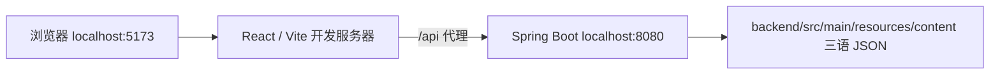
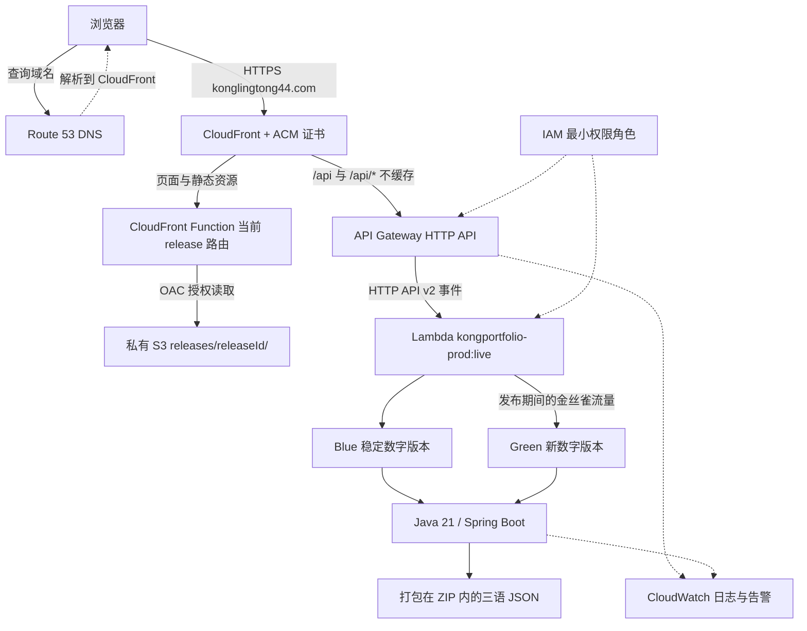
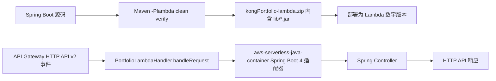
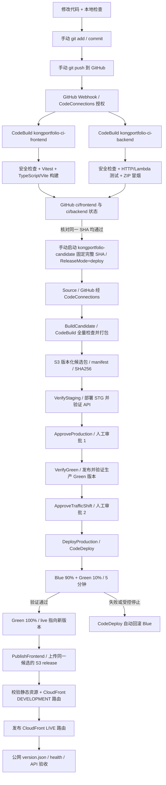

# kongPortfolio

持续开发中的个人网站，整理项目经历、技术栈与个人实践，提供正则表达式交互工具。前端使用 React / TypeScript / Vite，后端使用 Java 21 / Spring Boot。

在线访问：[konglingtong44.com](https://konglingtong44.com)。已实现 AWS 托管、CI/CD、Lambda 蓝绿与金丝雀发布；Amazon Bedrock Q&A 尚待接入，目前 `/api/bedrock` 仅返回 `PREPARING`。

2026-11-14 运维更新：[$5/$10/$15/$25费用关停与手动恢复](docs/aws-cost-control.md)已接通并验收；[旧练习资源已清理](docs/aws-resource-cleanup.md)。东京Qwen3 235B A22B 2507经Mantle及Java真实调用成功，Runtime Converse仍429；[Java有界问答](docs/bedrock-java.md)已在本地实现，默认关闭、尚未部署。实际命令与SDK操作见[补录](docs/aws-commands-20261114.md)。

费用取舍：当前低流量后端用Lambda，暂不部署ECS/ALB；简历采用[普通私有S3＋实例缓存＋全文提示](docs/bedrock-content.md)，暂不建知识库。脱敏后的履历资料已导入私有S3并保留旧摘要版本，Java读取／缓存及STG版本权限验证通过；正文不入Git，云端应用发布和问答质量验收待后续。

问答范围采用[严格白名单](docs/bedrock-scope.md)：17个审核主题、51个三语标准问句及有限别名；范围外在Java中返回固定提示，不读取资料、不调用模型。代码本地验证通过，尚未部署新接口或开放线上问答。

## 环境与本地启动

| 工具 | 要求／用途 |
|---|---|
| Node.js | 24.x，包含 npm；前端开发、测试与构建 |
| JDK | 21；配置 `JAVA_HOME`，将 `java`、`jar` 加入 PATH |
| Maven | 3.9.11+；后端构建与测试 |
| Git、Gitleaks | 版本管理、提交前秘密扫描；缺少扫描器时提交钩子会阻止提交 |
| PowerShell | Windows 一键启动及检查脚本 |
| AWS CLI v2、Terraform | 仅 AWS 运维需要；本地启动不需要 AWS 账号 |
| Docker Engine + Compose | 可选，仅用于本地容器集成 |

在仓库根目录执行：

```powershell
powershell -ExecutionPolicy Bypass -File .\scripts\install-hooks.ps1
powershell -ExecutionPolicy Bypass -File .\scripts\dev.ps1
```

启动脚本首次自动安装前端依赖、构建后端并启动两个进程。打开 **http://localhost:5173**，按 `Ctrl+C` 停止；5173、8080 需空闲。启动日志位于 `.local/frontend.log`、`.local/backend.log`，错误日志在同目录。



一键启动时，本地 JSON 按请求重新读取；Java 代码修改需重启后端。也可用两个终端分别启动（此方式默认读取构建时的 JSON，修改资料后需重启）：

```powershell
# 终端 1：仓库根目录
mvn -f backend/pom.xml spring-boot:run
```

```powershell
# 终端 2：仓库根目录
cd frontend
npm ci
npm run dev
```

可选容器启动（Docker 可用的终端中，在仓库根目录执行）：

```bash
docker compose up --build -d --wait
# 访问 http://localhost:3000
docker compose down
```

Compose 包含独立的前端 Nginx、后端 Java 容器；AWS 生产环境使用下面的 S3／Lambda 架构。

## AWS 运行架构

主区域为东京 `ap-northeast-1`；CloudFront 使用的 ACM 证书在 `us-east-1`。DNS 负责域名解析，HTTP 请求由 CloudFront 接收。



| 模块 | 本项目中的做法 |
|---|---|
| S3 + CloudFront | S3 禁止公开访问，通过 OAC 提供静态资源；按发布 ID 保存文件，CloudFront Function 切换当前版本并处理 SPA 路由 |
| Route 53 + ACM | A／AAAA 别名指向 CloudFront，ACM 提供 HTTPS 证书 |
| API Gateway | `/api`、`/api/*` 转发至 Lambda `live` 别名；默认速率 1 请求／秒，突发 5 |
| Lambda | Java 21、x86_64、1024 MB、超时 28 秒、预留并发上限 5；发布为不可变数字版本 |
| CloudWatch | 接收 API／Lambda／构建日志；部署期间检查告警。请求日志不记录请求体、查询参数或凭据 |
| IAM | 运行、构建、验证和发布各用对应角色；GitHub 通过 CodeConnections 授权连接 |
| Terraform | 管理基础设施、角色和配置；S3 远程 State 分为 bootstrap、portfolio、cicd、cost-control、bedrock-content，支持状态锁 |

Terraform 代码位于 `infra/terraform/bootstrap/`、`infra/terraform/portfolio/`、`infra/terraform/cicd/`、`infra/terraform/cost-control/`、`infra/terraform/bedrock-content/`。已有环境先恢复被忽略的本地输入，再执行 `fmt → validate/test → plan → 审核 → apply → plan`。基础设施变更与日常应用发布分开进行。

Terraform 管 Lambda 运行配置和 CloudFront 分发配置；流水线负责应用代码与前端发布指向，CodeDeploy 负责 Lambda `live` 的版本和流量权重。

## Lambda 如何运行 Spring Boot



入口为 `dev.kongortfolio.lambda.PortfolioLambdaHandler::handleRequest`，固定启用 Spring `lambda` profile。适配器把 Lambda 事件转换为 Spring 请求，暖调用复用静态 Spring 上下文，无需监听 8080。Lambda 只写控制台日志；健康检查磁盘路径设为可写的 `/tmp`。

| API | 用途 |
|---|---|
| `GET /api/health` | 健康状态 |
| `GET /api/profile?lang=ja\|zh\|en` | 三语资料，缺省／不支持的语言回退日语 |
| `POST /api/bedrock` | 预留问答接口，目前不调用真实模型 |

本地验证两种构建和 Lambda ZIP：

```powershell
mvn -B -ntp -f backend/pom.xml clean verify
mvn -B -ntp -f backend/pom.xml -Plambda clean verify
node scripts/test-lambda-package.mjs
```

默认构建生成可执行 `backend/target/kongPortfolio.jar`；Lambda 构建生成 `backend/target/kongPortfolio-lambda.zip`。两种构建共用 `target`，切换时使用 `clean`；Lambda 构建后的 JAR 不能直接用 `java -jar` 启动。详细实现见 [Lambda 适配说明](docs/lambda.md)。

## CI/CD：从手动提交到前后端上线

测试、构建、部署全部在 AWS 执行。**`git commit` 只提交到本地，`git push` 才触发云端 CI；push 不会自动启动生产发布。**



### 提交代码与触发前后端 Build

先运行本地检查，再查看差异、明确选择文件提交：

```powershell
powershell -ExecutionPolicy Bypass -File .\scripts\check.ps1
git diff
# git add -- 后填写本次确认过的文件路径
git add -- <本次修改的文件路径>
git commit -m "说明本次修改"
git push
git rev-parse HEAD
```

Webhook 接受仓库所有者推送的 `main`、`feat/*`、`feature/*`、`fix/*`、`hotfix/*`；符合规则、面向 main 的 PR 创建／重开也会触发。两个 CI 项目均接收事件，脚本按改动范围决定是否执行应用构建：只改前端时后端可跳过应用构建，反之亦然；公共配置改动会检查双方。秘密扫描及通用检查始终执行，无法确定差异基线时执行应用检查。

到 AWS **CodeBuild → 构建项目 → `kongportfolio-ci-frontend`／`kongportfolio-ci-backend` → 构建历史** 查看结果；核对 `resolvedSourceVersion` 是本次 SHA，并查看 GitHub 对应的 `ci/frontend`、`ci/backend`。

需要手动重跑 CI 时，可在对应项目选择 **开始构建**，将源码版本指定为完整 SHA；也可使用 CLI：

```powershell
$env:AWS_PROFILE = 'kong-dev'
aws sso login --profile kong-dev
$releaseSha = git rev-parse HEAD
aws codebuild start-build --project-name kongportfolio-ci-frontend --source-version $releaseSha --region ap-northeast-1
aws codebuild start-build --project-name kongportfolio-ci-backend --source-version $releaseSha --region ap-northeast-1
```

CI 项目只有验证权限，不修改生产环境。脚本入口为 `codebuild/ci.yml → scripts/ci.sh frontend|backend`。

### 手动启动生产流水线

确认源码已推送、同一 SHA 的 CI 通过后，打开 [AWS CodePipeline：kongportfolio-candidate](https://ap-northeast-1.console.aws.amazon.com/codesuite/codepipeline/pipelines/kongportfolio-candidate/view?region=ap-northeast-1)。发布固定提交建议使用以下 CLI，避免误用分支上的其他版本：

```powershell
$releaseSha = git rev-parse HEAD
aws codepipeline start-pipeline-execution --name kongportfolio-candidate --source-revisions "actionName=GitHub,revisionType=COMMIT_ID,revisionValue=$releaseSha" --variables "name=ReleaseMode,value=deploy" --region ap-northeast-1
```

| 阶段 | 执行内容／你需要做的事 |
|---|---|
| Source → BuildCandidate | 取得固定提交，重新全量检查并生成前后端候选包、manifest 与校验摘要 |
| VerifyStaging | 部署到独立 STG Lambda，检查健康、三语资料及 API 契约 |
| ApproveProduction | 你检查本次 SHA、候选和 STG 报告后，在 **Review／审查** 中完成审批 1，授权创建及验证 Green |
| VerifyGreen | 发布生产函数的新数字版本，直接调用验证；此时生产流量仍在 Blue |
| ApproveTrafficShift | 你核对同一执行的 Blue／Green、发布模式和报告后完成审批 2，授权生产切流及同候选前端发布 |
| DeployProduction | CodeDeploy 执行 Lambda 蓝绿：先 10%／5 分钟，再 100%；异常请求停止并自动回滚 |
| PublishFrontend | 后端成功后发布同一候选的前端；校验 S3 资源和 CloudFront 路由后切换 LIVE |

候选在 STG、Green、生产之间复用同一制品，不重新构建；流水线执行采用 QUEUED 排队。每次新执行都需要两次新审批。`ReleaseMode=rollback_drill` 专门用于在观测到 10% 后受控停止并验证自动回滚，不全量推广，也不发布前端。

后端已验证真实金丝雀切流和受控停止自动回滚；前端是版本化发布与路由切换，没有执行双环境渐进灰度。前端发布脚本包含失败时恢复旧指向的逻辑，但 LIVE 发布后的真实故障回退、后端应用故障／CloudWatch 告警触发回滚尚未分别演练。

发布后核对流水线全部阶段及报告，并检查：

```powershell
Invoke-RestMethod https://konglingtong44.com/version.json
Invoke-RestMethod https://konglingtong44.com/api/health
```

`version.json` 用于核对前端源码与发布标识，`health` 用于检查后端；它们不能代替完整功能验收。CodeBuild 日志、CodeDeploy 流量与回滚记录、CloudWatch 告警可用于排查失败。

## 检查、安全与目录

`scripts/check.ps1` 包含前端测试／构建、后端 HTTP／Lambda 测试、ZIP 冒烟、秘密与私密路径扫描、钩子和路由检查；有 Docker 命令时检查 Compose 配置，**不会构建或验证容器运行**。

不提交 `.env`、密钥、密码、证书、个人源资料或 `.local/`。本机 AWS 使用 SSO，AWS 服务使用 IAM Role，GitHub 连接使用 CodeConnections。新增付费 AWS 资源须先明确批准。

| 路径 | 内容 |
|---|---|
| `frontend/` | 页面、交互、样式、前端测试 |
| `backend/` | Spring API、三语 JSON、Lambda 入口及后端测试 |
| `infra/terraform/` | State、网站与 CI/CD 基础设施 |
| `codebuild/` | 各构建／验证／发布阶段的 buildspec |
| `scripts/` | 本地启动、检查、候选打包与发布控制脚本 |
| [AWS_LEARNING_GUIDE.md](AWS_LEARNING_GUIDE.md) | 按步骤学习首次搭建，第 22 步为日常发版 |
| [AWS_EXECUTION_LOG.md](AWS_EXECUTION_LOG.md) | 实际操作、失败修复和验证历史 |
| [2026-11-13～14命令补录](docs/aws-commands-20261114.md) | 模型调查、费用部署、停站演练、删除与429的实际命令／SDK操作 |
| [前后端发布记录](docs/frontend-publication.md) | 完整发布验收结果与边界 |
