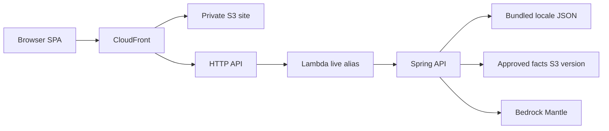
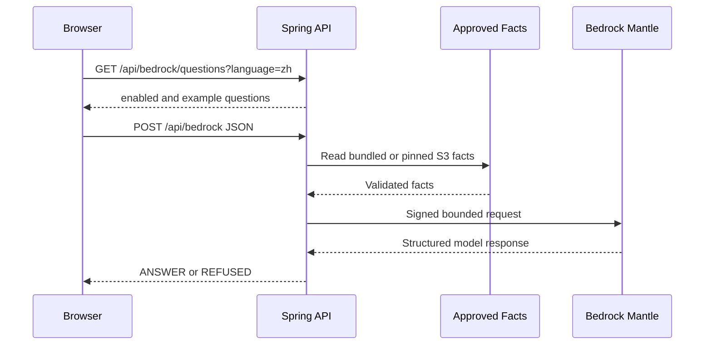

# Architecture Analysis

## System Overview
React/Vite SPA calls a Spring Boot HTTP API. In the Terraform configuration, CloudFront serves files from a private S3 origin and forwards `/api/*` to API Gateway, which invokes the Java Lambda through a `live` alias. Spring serves bundled locale JSON and optionally calls Bedrock Mantle with approved facts, using an immutable private S3 object version in the configured AWS path (`docs/architecture/overview.md:1-30`; `infra/terraform/portfolio/api.tf:31-110`; `ApprovedFacts.java:49-84`). Local Vite proxies `/api` to Spring on loopback (`frontend/vite.config.ts:5-9`).

## Architectural Style
Single SPA plus one Spring API, adapted to serverless for the AWS target. `PortfolioLambdaHandler.java:15-29` uses the HTTP API v2 container adapter and reuses its static Spring context. Docker Compose is a local integration path (`compose.yaml:1-22`); no database or ECS/ALB service is in this target.

## Component Relationships

Text fallback: Browser obtains static SPA through CloudFront/S3; API requests pass through CloudFront and HTTP API to the live Lambda/Spring application. Profile reads bundled JSON. Enabled Q&A reads a fixed approved facts version and calls Mantle.

## Data Flow
The UI validates the profile shape after `GET /api/profile?lang=...` (`frontend/src/profile.ts:1-34`; `App.tsx:60-76`). For Q&A, frontend `bedrock-api.ts:31-53` loads examples then POSTs `{message, language}`. Controller rejects invalid entry/size and returns `ANSWER`, `REFUSED`, `PREPARING` or `ERROR` shapes (`BedrockController.java:27-77`). The service limits local concurrency/rate, constrains prompt facts and validates the model's structured output (`QuestionService.java:40-76,143-149`).

## Key Design Decisions
- Profile content is file-backed and locale based; no persistence layer (`ProfileService.java:21-49`).
- AWS pipeline stages and both manual approvals are explicit in Terraform (`infra/terraform/cicd/candidate-pipeline.tf:209-390`), with Lambda canary routing declared in CodeDeploy (`deployment.tf:48-55`). This describes repository configuration, not a live deployment check.
- API Gateway Q&A route has a tighter best-effort throttle (`infra/terraform/portfolio/api.tf:121-139`); the service also has per-instance bounds.

## Improvement Opportunities
Documentation moves need systematic link rewriting because the local checker resolves relative paths. Reassess uncovered tests, scripts and Terraform roots before changing their paths. Keep Terraform root/state boundaries stable.

## Interaction Diagrams

Text fallback: browser retrieves examples, submits a question; Spring validates it, reads approved facts, signs a bounded model request, validates response and returns an answer or refusal. Disabled Q&A returns preparation status without model invocation.
