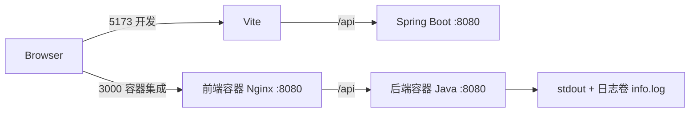
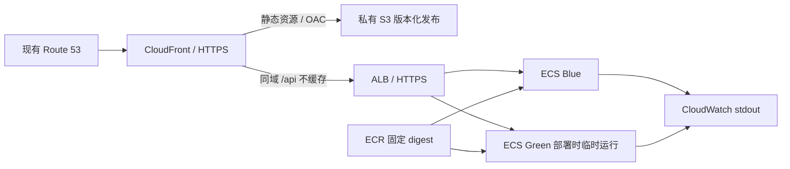

# 架构与边界

问答入口的最新限制为[Java严格白名单](bedrock-scope.md)：完整匹配审核问句后，才读取资料并把固定主题模板交给模型；访客原文不进入模型。范围外返回三语可问范围／建议问句，零生成模型tokens。STG24及Green20已验收，源码978a636已通过两道人审发布至生产20／同候选网页。本轮自由输入与回答风格修改仍在本地，不改变匹配策略；没有新增Guardrails／分类模型服务。

简历资料选型：基于约5000到一万多汉字、每月约1000次访问的规模，暂不建知识库／向量数据库，采用[普通私有S3＋Lambda实例缓存＋全文输入](bedrock-content.md)，减少额外组件费用和维护。资料、生产角色及版本20已部署；缓存不减免每次模型输入tokens。以下ECS/ALB章节保留为早期规划。

2026-11-14 当前补充：独立费用控制Lambda经Budgets→SNS接收$5/$10/$15/$25通知，原配置保存在私有S3，控制正式站／后端／CI开关，结果邮件与失败队列保留；见[费用控制](aws-cost-control.md)。东京Qwen经Mantle及Java实际连通，单项目／单模型业务权限和费用双入口Deny均已部署；代码默认仍关闭，生产20通过审核配置启用，见[模型访问](bedrock-access.md)。两道生产发布审批不变。

当前目标已由用户改为 Lambda + HTTP API，见 [当前 Serverless 路线](../README.md#aws-运行架构)。下文保留原 ECS/ALB 设计作历史参考，不作为当前执行计划；本地部分仍适用。State 已创建、AWS 预检已完成，不能再按下文旧 Phase 1 状态判断现状。

状态：本地已实现；AWS 全部 Planned。Phase 1 不创建资源，不改变 5173/8080/3000 端口。

## 当前

两个 Dockerfile、两个服务、独立进程/文件系统/生命周期。`depends_on` 只协调本地启动；后端不对宿主机开放端口。前端生产构建是 `dist` 静态文件，Vite 用于构建和本地开发，Nginx 用于本地容器集成。

统一 Filter 记录所有 `/api` 请求（含 health、404），不记录 query、Headers、body；INFO 文件滚动，WARN/ERROR 保留在控制台。未来若启用异步/流式接口，需扩展为异步完成时记录；当前 API 为同步。

## AWS 目标 — Planned

S3 开启 Block Public Access，用 REST origin + OAC，不能改用 website endpoint。Bucket policy 仅授予指定主/暂存分发读取必要前缀。[AWS OAC](https://docs.aws.amazon.com/AmazonCloudFront/latest/DeveloperGuide/private-content-restricting-access-to-s3.html)

CloudFront viewer 强制 HTTPS，证书在 us-east-1；ALB origin 使用同区域 ACM 证书和匹配的 origin 域名，TLS 1.2+。DNS 和证书尚未配置。

低成本候选：公网 ALB 双子网；任务在公网子网分配公网 IPv4，任务 SG 仅允许 ALB SG 访问 8080，无公网入站，避免 NAT 常驻费用。这是成本取舍，非私网任务；私网任务需要另计 NAT 或 ECR/Logs 等 VPC endpoints。ALB SG 限 CloudFront origin-facing managed prefix list 的 443，并校验 CloudFront 注入的源站自定义 Header，其余默认 403；Header 不进入源码、日志或前端。测试 listener 只允许验证 runner。[限制 ALB 来源](https://docs.aws.amazon.com/AmazonCloudFront/latest/DeveloperGuide/restrict-access-to-load-balancer.html)

## 请求/缓存策略 — Planned

| Behavior（先匹配 API） | Origin / 策略 |
|---|---|
| `/api` 和 `/api/*` | ALB；允许全部 7 种 CloudFront HTTP methods，后端仍拒绝未实现方法；Managed CachingDisabled，TTL=0；Origin Request Policy 转发 query、所需 cookies/headers（含 Authorization），AllViewerExceptHostHeader 或验证后的等效策略；Host 使用 origin 域名；错误缓存 TTL=0 |
| `/releases/*` | S3；GET/HEAD，路径包含 release SHA，同 key 不覆盖；JS/CSS/图片 `public,max-age=31536000,immutable`，index/version.json 仍为 no-cache；策略 MinTTL=0，遵循对象 Cache-Control |
| 默认 SPA | S3；GET/HEAD；viewer-request Function 将无扩展名路由重写到当前 release index，排除 API/资源；index/version.json 为 `no-cache,max-age=0,must-revalidate`，CloudFront MinTTL=0 |

不要全局把 403/404 转成 index.html，否则 API 错误和缺失 JS 都会被吞成 HTML。SPA Function 必须有路径/方法测试。[请求方法与 Headers](https://docs.aws.amazon.com/AmazonCloudFront/latest/DeveloperGuide/RequestAndResponseBehaviorCustomOrigin.html)

Phase 1 不部署 S3/ECS、不连接 Bedrock、不创建长期 Access Key、不把 CI 验证包当生产发布。现有域名由用户提供，未对 hosted zone/证书/账号套餐作在线确认。
