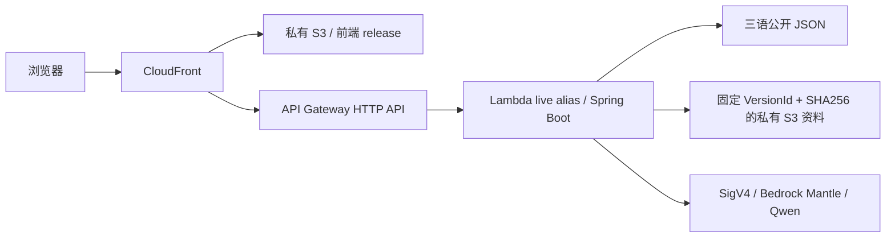

# 当前实现地图

2026-11-17 按仓库代码整理；没有查询本轮 AWS 实际状态。最近保存的发布证据见[生产26记录](../history/releases/bedrock-staging-language-fix.md)。

| 边界 | 代码入口 | 当前行为 |
|---|---|---|
| 页面 | [App.tsx](../../frontend/src/App.tsx)、[i18n.ts](../../frontend/src/i18n.ts) | 三语选择、资料加载、章节组合 |
| 问答前端 | [features/qa](../../frontend/src/features/qa/) | 组件、接口、三语文案、样式与测试按功能归类 |
| 正则工具 | [features/regex](../../frontend/src/features/regex/) | 组件与解析测试同目录；共享文案、全局样式暂留原位 |
| 个人展示 | [features/profile](../../frontend/src/features/profile/) | 介绍时间线、技能展示、相关样式和时间线测试；共享资料类型仍在src/profile.ts |
| 手机交互 | [useMobileLayout.ts](../../frontend/src/useMobileLayout.ts)、[约定](../product/mobile-layout.md) | 01/02 收展、03 自然滚动，独立手势与说明气泡 |
| 公开资料 | [ProfileService.java](../../backend/src/main/java/dev/kongortfolio/profile/ProfileService.java) | classpath JSON；开发启动可按请求重读本地公开资料 |
| 问答 | [BedrockController.java](../../backend/src/main/java/dev/kongortfolio/bedrock/BedrockController.java)、[QuestionService.java](../../backend/src/main/java/dev/kongortfolio/bedrock/QuestionService.java) | 限定入口、输入大小／语言、一次语义判断与回答、结构与语言校验 |
| 审核资料 | [ApprovedFacts.java](../../backend/src/main/java/dev/kongortfolio/bedrock/ApprovedFacts.java) | 固定 S3 版本、校验摘要、实例缓存，失败关闭 |
| 模型传输 | [MantleGateway.java](../../backend/src/main/java/dev/kongortfolio/bedrock/MantleGateway.java) | 服务端签名、受限响应、超时、无自动模型重试 |
| Lambda | [适配入口](../../backend/src/lambda/java/dev/kongortfolio/lambda/PortfolioLambdaHandler.java) | HTTP API v2 → Spring，暖请求复用上下文 |

问答是单次、无工具执行的有界生成流程。示例问题不是白名单；语义拒答也可能消耗 tokens。实例内限流不等于全站总限额。没有部署向量数据库、知识库或自主 Agent；学习这些概念不构成个人工作经历。

## 部署所有权

| 管理者 | 管什么 |
|---|---|
| Terraform `bootstrap` | State 基础设施 |
| Terraform `portfolio` | 网站、API、函数配置、域名等基础设施 |
| Terraform `cicd` | 连接、构建、流水线、审批及交付角色 |
| Terraform `cost-control` | 费用通知与关停设施 |
| Terraform `bedrock-content` | 私有资料存储及版本读取权限 |
| AWS 流水线 / CodeDeploy | 同一候选制品、函数数字版本、live 流量与前端 release 指向 |

日常应用发布不重建基础设施。已有五个根栈及各自 State key 保持稳定，不能仅为目录美观迁移。Docker/Compose 用于本地集成，ECS/ALB 留作以后练习。

进一步阅读：[部署](../deployment/README.md)、[AI](../ai/README.md)、[Lambda](lambda.md)、[恢复机制](recovery-map.md)。旧架构规划已放入[历史记录](../history/architecture.md)。
