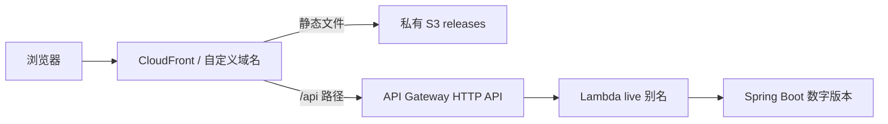

# AWS 从零上线复习索引

**按第1步开始学习，请读最新独立文档：[AWS学习手册](../AWS_LEARNING_GUIDE.md)。** 包含目的、工具、命令作用、鼠标入口、实际结果；后续学习只列标题。下面保留日志复盘索引，供追溯历史。

完整人工作业复盘已补到根目录 [AWS_EXECUTION_LOG.md 第27章](../AWS_EXECUTION_LOG.md#27-从github代码到aws完整发布人工作业复盘2026-11-12补记)。保留原始日志，没有用新教程替换历史。

读法：每次只走一段，先看目的，再看文件/命令、控制台入口、成功证据、当时故障。创建和启动命令是历史，当前环境无需重新创建。

| 顺序 | 根日志小节 | 你要弄懂的问题 |
|---|---|---|
| 1 | 27.1 | 本机如何用SSO登录AWS？Terraform首次测试到底证明了什么？ |
| 2 | 27.2 | State为什么先放本地，再迁S3？锁如何验证？ |
| 3 | 27.3 | 预算/旧资源为什么先盘点？哪些东西没新建？ |
| 4 | 27.4–27.5 | Spring Boot如何变Lambda ZIP？候选包为什么不能随便改？ |
| 5 | 27.6–27.7 | 首次23项环境如何建？React如何上传？health故障如何查修？ |
| 6 | 27.8 | 注册域名、NS委派、Route53记录、ACM证书分别谁来做？ |
| 7 | 27.9 | Terraform和你本人分别完成GitHub连接哪一半？ |
| 8 | 27.10–27.11 | CI怎么跑？push怎么触发？App权限错误如何修？ |
| 9 | 27.12–27.14 | 同一候选如何经过STG、两次人审和Green？ |
| 10 | 27.15–27.16 | CodeDeploy如何灰度？真正回滚过哪条路径？ |
| 11 | 27.17 | React如何自动上传、测试路由、切CloudFront指向？ |
| 12 | 27.18–27.19 | 你日常怎样亲手发版？还有哪些没做或缺记录？ |

网站请求路径：

发布流程是另一条链：GitHub源码 → AWS构建候选 → STG验证 → 人审1 → Green验证 → 人审2 → CodeDeploy后端灰度 → S3/CloudFront前端发布。

当前已验收：后端8，前端242f8cb4…，源码7a2e1b8，完整执行5d55596a…成功。日常push触发CI，生产流水线仍手动启动，两道人审保留。Bedrock仍为PREPARING占位。

最早工具安装和IAM Identity Center/profile的逐点击记录缺失；日志明确标出，不会把重建教程冒充历史。其余主线已能从执行记录、源码及报告追溯。
