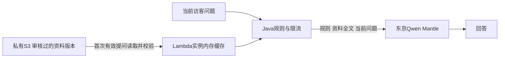

# 费用取舍：简历全文＋私有S3，暂不建知识库

用户决定：简历约5,000汉字，补充后最多一万多字，月访问约1,000次。当前优先减少额外服务和维护成本，采用普通私有S3保存脱敏、审核过的资料，Lambda在内存缓存固定版本，每次把全文与规则、当前问题交给Qwen。没有创建知识库、Embedding流水线、向量数据库或OpenSearch。

这与当前后端选Lambda、不部署ECS/ALB的取舍原则一致：按项目当前低流量规模，减少不必要的常驻资源及额外组件。并不表示ECS或知识库永远不适合，也不表示所有知识库每月都要$170／$975；现有便宜的托管方案仍可在未来比较。

## 费用含义

省去知识库检索、索引及可能的向量存储等新增费用；保留S3少量存储／读取及模型输入输出费用。缓存只减少重复S3读取和相关延迟，**每次发送给Qwen的全文仍计输入tokens**。

按已核对的东京Mantle Standard输入$0.27／百万tokens，假设每次资料占10,000／20,000 tokens，1,000次对应资料输入约$2.70／$5.40；汉字不等于tokens，未含规则、问题、回答、税及其他AWS服务。拿到完整资料后需测真实token用量；若全文成本／延迟较高，再比较检索方案，不宣称当前方案在所有用量下绝对最便宜。参见[模型价格](bedrock-java.md)。

## 实际实现

- 独立Terraform根栈[bedrock-content](../infra/terraform/bedrock-content/README.md)，复用State桶，独立key=`bedrock-content/terraform.tfstate`，避免修改网站／CI/CD／费用控制根栈。
- 普通S3桶`kongportfolio-content-561798268037-ap-northeast-1`，固定对象`approved/facts.txt`；禁用公网／ACL、SSE-S3加密、强制HTTPS、版本控制、旧版本90天过期，当前对象无自动过期。
- 应用配置只包含bucket、version、SHA-256和owner；不把简历正文放Lambda环境变量（合计上限4KB）。STG角色只读这个对象已批准的版本，不获Put/Delete/List/GetObject最新版本权限；生产角色没有新增读取权限。
- Java `ApprovedFacts`仅在实际问答需要资料时读取，SDK客户端懒创建，启动／health／空POST探测不读取S3。固定版本＋SHA-256＋UTF-8校验，最多20,000 Unicode码点及80KiB；超限／缺失／摘要不匹配返回FACTS_UNAVAILABLE，模型不调用，不静默换成旧资料。
- 读取成功后在同一实例内复用只读String；扩容／新执行环境各自读取一次。资料只由维护者更新，不缓存访客聊天，不自动学习访客断言。符合[Lambda执行环境复用建议](https://docs.aws.amazon.com/lambda/latest/dg/best-practices.html)。

## 当前状态与下一步

2026-11-14首次创建：真实apply 9新增／0更新／0删除，包含桶及保护配置、初始公开摘要（623码点）、STG只读inline policy。随后用户提供本地DOC，已在本机提取、核对并整理为6,875码点／17,433字节的脱敏问答资料，涵盖7段职业项目经历、技能、学业和资格取得记录；更新现有对象和STG批准版本权限，0新增／2更新／0删除，旧摘要版本保留。原始DOC未修改、未上传，问答资料正文及提取物均未加入Git。

用户确认当前任职／项目未变，并确认一项资格未续证；资料明确区分取得历史和当前有效资格，未编造转职理由。私人联系方式、年龄等非必要字段、雇主实名和内部项目固有名未进入云端问答资料。准备了21个三语／事实边界／隐私／跨访客隔离验收问题，**仅为待执行样例，不代表模型质量已通过**。

后续[严格白名单](bedrock-scope.md)替换了“可回答通用算法／数学”这一旧范围条款，职业事实不变；当前资料为6,943码点／17,637字节，仅对象和STG版本权限2更新，保留此前版本。新验收集为17主题／51个三语标准问句；原21个样例属于旧范围，不直接作为最新验收依据。未执行新模型调用或部署应用。

云端应用未部署新代码、未设置资料环境变量，Bedrock模型权限／开关仍关闭，线上仍PREPARING。当前资料已备好，下一Story审查STG配置／IAM及发布，再执行真实问答验收。

真实验证：Java用SSO读取新资料指定版本，6,875码点、内容／SHA-256匹配、第二次复用缓存，没有推理调用。真实IAM模拟8项：新资料／旧摘要回退版本allowed，其他版本／对象、写、删、列举、最新版本读取均implicitDeny。新旧对象均下载核对，最终真实plan No changes，站点health和费用开关正常；见[操作补录第11节](aws-commands-20261114.md)。

后续资料仍先整理成供访客查询的UTF-8脱敏文本，放本机ignored `.local/`，不上传Git。资料版本与应用版本分开：上传新版本后，把仍供live／Green／回滚使用的旧版本留在`rollback_version_ids`；再审查STG资料配置与发布，验证后按原两道审批推进生产。不能只覆盖S3文件就声称所有Lambda实例会立即更新。

资料桶和历史版本在费用关停时保留，仍有小额存储费；不删除资料来模拟暂停。S3与模型按实际用量收费，不承诺免费或固定月费。
