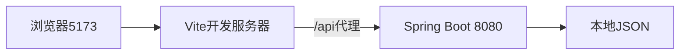

# 01｜先在电脑上运行，再准备Lambda包

[上一章](00-start.md) · [学习路线](README.md) · [下一章](02-first-site.md)

本章只在本机操作。只看网站时，不需要AWS登录，也不必加载00的AWS上下文。

## 1. 启动与停止

PowerShell工作目录：仓库根目录。

```powershell
. ./scripts/tools.ps1
./scripts/install-hooks.ps1
./scripts/dev.ps1
```

| 命令 | 做了什么 |
|---|---|
| tools.ps1 | 加载当前用户的工具PATH和JAVA_HOME |
| install-hooks.ps1 | 让本仓库提交／推送前执行秘密扫描，缺少Gitleaks则拒绝提交 |
| dev.ps1 | 检查5173／8080端口，必要时安装前端依赖，构建Java，启动前后端并等待健康检查 |

启动实现现位于 [scripts/dev/dev.ps1](../../scripts/dev/dev.ps1)，原来的 [scripts/dev.ps1](../../scripts/dev.ps1) 保留为兼容入口，所以上面的命令不变。路径按脚本位置解析，工作目录变化不会改变仓库根定位；迁移验证见[Story003](../stories/003-dev-launcher.md)。

打开 `http://localhost:5173`，应看到页面，项目卡片能打开，开发手记能阅读。在运行脚本的终端按 `Ctrl+C`，脚本会停止它启动的两个进程。



页面文件保存后通常自动更新；本地JSON按请求读取，Java源码修改需要重启后端。检查：

```powershell
Invoke-RestMethod http://localhost:5173/api/health
Invoke-RestMethod 'http://localhost:5173/api/profile?lang=ja'
```

健康结果应为 `UP`。项目内容在 `backend/src/main/resources/content/profile-*.json`；修改自己的内容时，不把没有做过的项目、资格或职责写成事实。

## 2. 遇到端口占用

如果 `dev.ps1`说5173或8080被占用，先找之前运行开发服务的终端并按Ctrl+C。也可只读查看：

```powershell
Get-NetTCPConnection -State Listen |
  Where-Object { $_.LocalPort -in 5173,8080 } |
  Select-Object LocalPort,OwningProcess
```

`OwningProcess`是进程ID。用任务管理器或 `Get-Process -Id <实际PID>`确认它确实是你准备停止的开发进程，再 `Stop-Process -Id <实际PID>`；不把未知进程一律杀掉。

页面空白时先查 `.local/frontend.log`、`.local/backend.log`及对应 `*-error.log`。直接打开8080的API能通、5173不通，优先检查前端服务和代理。

## 3. 检查代码

仍在仓库根目录：

先在开发服务终端按Ctrl+C停止服务，再执行包含 `npm ci` 的检查。Windows上的Vite可能占用原生依赖文件；运行中重装依赖会报 `EPERM ... unlink`，并可能留下未安装完整的依赖。遇到时先停服务，再重跑 `npm ci`，不要直接以管理员权限强删占用文件。

```powershell
npm.cmd --prefix frontend ci
npm.cmd --prefix frontend test
npm.cmd --prefix frontend run build
mvn.cmd -B -ntp -f backend/pom.xml clean verify
```

- `npm ci`按锁文件安装依赖，不随意升级包。
- `test`运行前端测试；`build`先做TypeScript检查，再生成浏览器文件。
- Maven的 `clean verify`清理旧输出、编译、测试、打包Java。

完成标准是命令退出0、测试无失败。生产26修复时是前端81、后端44项；以后增加测试后数量会变化。

## 4. Spring Boot为什么还要适配Lambda

本地Spring Boot持续监听8080；Lambda收到的是API Gateway事件。仓库中的Java适配器把事件转换给Spring Controller，再把响应转回网关格式。选择Maven的 `lambda`配置构建这部分：

```powershell
mvn.cmd -B -ntp -f backend/pom.xml -Plambda clean verify
node scripts/test-lambda-package.mjs
```

生成 `backend/target/kongPortfolio-lambda.zip`。第二条命令真正从ZIP运行检查，不只是确认文件存在。生产26修复时有5项适配测试；通过不代表Docker镜像也构建过。

## 5. 冻结第一次部署的文件

```powershell
./scripts/prepare-first-release.ps1
```

该脚本重新构建和检查前后端，生成 `.local/releases/<本次releaseId>/`，不调用AWS。末尾会打印 `First-release candidate:` 和完整目录。

| 文件 | 用途 |
|---|---|
| backend.zip | Lambda运行包 |
| frontend/ | 对应的HTML、JS、CSS和version.json |
| manifest.json | 来源提交、文件清单及校验值 |

把打印的完整目录留给02章。releaseId不是Git提交号：它标识一组构建输入；Git SHA标识源码提交。不要修改已经冻结的文件。再次准备时若提示同一候选已存在，可以复用原目录，不能强行覆盖。

## 6. 提交与秘密检查

```powershell
git status --short
git diff --check
node .githooks/check-staged-paths.mjs --all
gitleaks dir --redact --no-banner .
```

明确选择要提交的源码后使用 `git add <实际文件>`、`git commit -m '<说明>'`、`git push origin feat/aws-serverless-ci`。不提交 `.local`、`.env`、真实变量、State、计划文件、密钥或证书，不用 `git add .`把私有资料顺手上传。

**完成标准：** 页面和API能运行；测试、前端构建、Lambda ZIP检查通过；首次候选目录存在且内容未修改。进入[02](02-first-site.md)。
