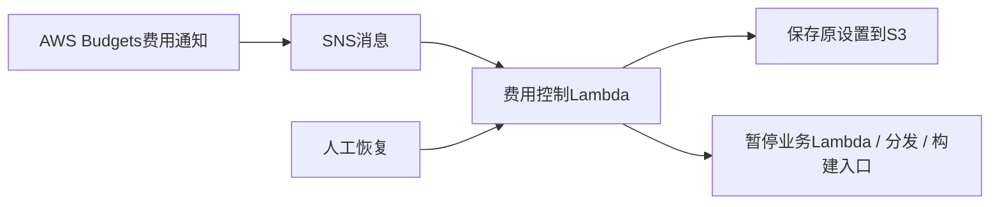

# 04｜先知道怎么停，再开启AI

[上一章](03-delivery.md) · [学习路线](README.md) · [下一章](05-ai.md)

目标：区分“费用通知”“暂停服务”“删除资源”。本章部署会新增预算、SNS、控制Lambda、S3状态、日志等，可能收费；暂停和恢复是实际业务写操作。

## 1. 这套机制会做什么



本项目月度 `$5 / $10 / $15 / $25` 四档各消费一次；恢复后不因同一旧档重复停站，下个月不自动开站。费用统计和通知都有延迟，不是精确硬额度。域名、DNS托管、存储、日志等不会因网站暂停而全部停止计费。

## 2. 获取自己的CloudFront ID

仓库根目录，加载00章上下文：

```powershell
. ./.local/learning-context.ps1
$CloudFrontUrl = (terraform -chdir=infra/terraform/portfolio output -raw cloudfront_url).Trim()
$CloudFrontHost = ([uri]$CloudFrontUrl).Host
$DistributionId = (aws cloudfront list-distributions --query "DistributionList.Items[?DomainName=='$CloudFrontHost'].Id | [0]" --output text).Trim()
if ($DistributionId -eq 'None' -or -not $DistributionId) { throw '没有找到目标CloudFront分配' }
$DistributionId
```

控制台等价查看：**CloudFront → Distributions → 对应默认域名 → ID**。必须是自己的分配ID；`cost-control/main.tf` 的历史默认ID属于原网站，不能照用。

## 3. 初次部署，先不接自动停站通知

```powershell
$CostInput = Join-Path $RepoRoot '.local/cost.learning.tfvars.json'
$Email = Read-Host '接收结果通知的自己的邮箱'
Set-LearningJson $CostInput @{
    expected_account_id = $AccountId
    notification_email = $Email
    distribution_ids = @($DistributionId)
    arm_notifications = $false
}
$CostBackend = Join-Path $RepoRoot '.local/cost.backend.hcl'
$text = @"
bucket = "$StateBucket"
key = "cost-control/terraform.tfstate"
region = "ap-northeast-1"
encrypt = true
use_lockfile = true
allowed_account_ids = ["$AccountId"]
"@
[IO.File]::WriteAllText($CostBackend, $text, $Utf8NoBom)
terraform -chdir=infra/terraform/cost-control init "-backend-config=$CostBackend"
terraform -chdir=infra/terraform/cost-control validate
terraform -chdir=infra/terraform/cost-control test
terraform -chdir=infra/terraform/cost-control plan "-var-file=$CostInput" "-out=$RepoRoot/.local/cost-first.tfplan"
terraform -chdir=infra/terraform/cost-control show "$RepoRoot/.local/cost-first.tfplan"
# 审核预算、消息、控制函数及其权限范围后才实际创建：
terraform -chdir=infra/terraform/cost-control apply -input=false "$RepoRoot/.local/cost-first.tfplan"
```

先完成03章，使控制器需要管理的项目名称和角色真实存在。此处不创建新的业务发布审批，也不修改线上版本。`arm_notifications=false`表示预算尚未自动触发控制器；资源本身已创建，仍有各自费用。

邮箱收到SNS订阅确认信后，点击 **Confirm subscription**。控制台 **SNS → Subscriptions** 应由Pending变成Confirmed。

## 4. 初始化已有费用基线

到 **Billing → Bills／Cost Explorer** 和 **Budgets**核对本月费用及其统计时间。域名等费用可能已跨过前几个档位，不能把预算当作“从此刻起再花5美元”。

```powershell
$Baseline = [decimal](Read-Host '刚核对的本月费用下限USD；没有费用时填0，不猜值')
./scripts/cost-control.ps1 -Action initialize -Profile kong-dev -ExpectedAccountId $AccountId -BaselineUsd $Baseline
./scripts/cost-control.ps1 -Action status -Profile kong-dev -ExpectedAccountId $AccountId
```

`initialize`只用于尚未初始化的状态；已有状态会拒绝再次初始化。它把已经跨过的档位记为已消费。不要随便填更高金额，否则会提前消费尚未达到的保护档位。

## 5. 测试真实暂停与恢复

先选择没有进行中发布的窗口，确认能接受网站暂时不可用，再按顺序执行：

```powershell
# 实际停站：不是只读测试。
./scripts/cost-control.ps1 -Action off -Profile kong-dev -ExpectedAccountId $AccountId
./scripts/cost-control.ps1 -Action status -Profile kong-dev -ExpectedAccountId $AccountId
# CloudFront关闭可能需要传播，检查完成后再恢复。
./scripts/cost-control.ps1 -Action on -Profile kong-dev -ExpectedAccountId $AccountId
./scripts/cost-control.ps1 -Action status -Profile kong-dev -ExpectedAccountId $AccountId
```

控制台等价：**Lambda → kongportfolio-cost-control → Test**，选择Terraform创建的共享事件：`check-status`只查状态，`manual-stop`实际停站，`manual-start`恢复。不是对任意Lambda随便建一个相同事件就会生效。

完成标准：停止时业务Lambda并发为0、对应模型调用权限被拒、相关构建／发布入口暂停、CloudFront状态按预期变化；恢复后回到保存的原设置，页面与API重新正常。它不会复活被停止的旧流水线，也不等于发布回滚。

## 6. 最后接通自动通知

初始化、邮件确认和停／开检查完成后：

```powershell
Set-LearningJson $CostInput @{ arm_notifications = $true }
terraform -chdir=infra/terraform/cost-control plan "-var-file=$CostInput" "-out=$RepoRoot/.local/cost-arm.tfplan"
terraform -chdir=infra/terraform/cost-control show "$RepoRoot/.local/cost-arm.tfplan"
# 确认只接通本项目预期通知链后：
terraform -chdir=infra/terraform/cost-control apply -input=false "$RepoRoot/.local/cost-arm.tfplan"
```

去 **Budgets → 对应预算 → Notifications**、**SNS → 对应topic → Subscriptions**核对链路。不要向“尚未消费的关停档位”发测试消息，否则可能真实关站。

## 留下什么记录

记录账号、控制器名称、目标分配ID、预算时间范围、初始化基线、停／开结果和剩余收费项。`.local`中的通知邮箱、计划和状态不提交Git。维护时保留 `arm_notifications=true` 的真实输入，不能拿默认false重新apply。

更完整的边界与已做过的演练见[费用控制记录](../operations/aws-cost-control.md)。预算通知本身不是保证不超支的产品，费用仍以AWS实际账单为准。
