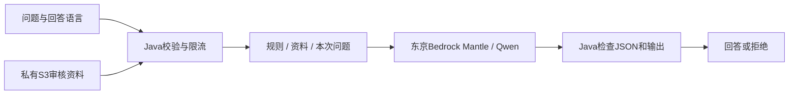

# 05｜接入有边界的AI问答

[上一章](04-cost-control.md) · [学习路线](README.md) · [下一章](06-operations.md)

前置：网站和完整发布链已通过，STG／生产角色已存在，费用关停已接通。本章会上传私有资料、增加运行权限并产生真实模型调用费用。

## 1. 先理解一次提问



Bedrock提供模型调用，Qwen生成文字，Mantle是调用入口。Java用Lambda执行角色的临时凭证签名；浏览器没有AWS密钥。一次模型调用同时判断范围和回答，语义拒绝也有token费用；不自动重试，不保存访客对话。

token是模型处理文本的计量单位，和字符数不一一对应；输入资料、规则和问题都计入输入量，生成内容计入输出量。提示词是随请求交给模型的文字规则，不是重新训练模型。

当前实现固定东京 `ap-northeast-1`、模型 `qwen.qwen3-235b-a22b-2507`，见 `MantleGateway.java`。同名模型在另一个API入口可能用不同ID、权限或配额，不能混用。[AWS模型卡](https://docs.aws.amazon.com/bedrock/latest/userguide/model-card-qwen-qwen3-235b-a22b-2507.html)、[入口说明](https://docs.aws.amazon.com/bedrock/latest/userguide/endpoints.html)

## 2. 先准备真实、可公开回答的资料

用编辑器创建 `.local/approved-facts.txt`，UTF-8保存。逐条审核自己允许网站回答的经历、技能和项目事实，去掉联系方式、客户／雇主实名、账号与秘密。不直接上传原始简历。

这份真实资料不在Git里；新读者必须自备，不能用作者的私有文件、版本号或经历。仓库的提问示例、提示词人物名和模型验收问题面向孔令通；为自己建站时，要同步修改 `QuestionScope.java`、`QuestionService.java`、页面资料，以及 `scripts/staging-contract.mjs` 中的人名、事实marker及相应测试。未知事实仍应回答未确认，拒绝／语言／边界检查不能为了通过而删除。

先做本地大小检查，不打印正文：

```powershell
. ./.local/learning-context.ps1
$FactsPath = (Resolve-Path .local/approved-facts.txt).Path
$FactsText = [IO.File]::ReadAllText($FactsPath, [Text.Encoding]::UTF8)
$Bytes = [Text.Encoding]::UTF8.GetByteCount($FactsText)
if ([string]::IsNullOrWhiteSpace($FactsText) -or $Bytes -gt 81920) { throw '资料为空或超过80KiB' }
Get-FileHash -LiteralPath $FactsPath -Algorithm SHA256
```

Java和Terraform还会检查最多20,000个Unicode码点。SHA-256用于后续确认文件内容；不是加密。正文保留在 `.local`，不要复制到环境变量、提交说明或构建日志。

## 3. 建私有资料桶，只给STG读取权限

```powershell
$ContentInput = Join-Path $RepoRoot '.local/content.learning.tfvars.json'
Set-LearningJson $ContentInput @{
    expected_account_id = $AccountId
    approved_text_path = $FactsPath.Replace('\','/')
    reader_role_names = @('kongportfolio-stg-lambda')
    rollback_version_ids = @()
}
$ContentBackend = Join-Path $RepoRoot '.local/content.backend.hcl'
$text = (Get-Content -Raw infra/terraform/bedrock-content/backend.hcl.example).Replace('<ACCOUNT_ID>', $AccountId)
[IO.File]::WriteAllText($ContentBackend, $text, $Utf8NoBom)
terraform -chdir=infra/terraform/bedrock-content init "-backend-config=$ContentBackend"
terraform -chdir=infra/terraform/bedrock-content validate
terraform -chdir=infra/terraform/bedrock-content test
terraform -chdir=infra/terraform/bedrock-content plan "-var-file=$ContentInput" "-out=$RepoRoot/.local/content-first.tfplan"
terraform -chdir=infra/terraform/bedrock-content show "$RepoRoot/.local/content-first.tfplan"
# 审核私有桶、版本化对象、指定STG角色的读取策略后才上传：
terraform -chdir=infra/terraform/bedrock-content apply -input=false "$RepoRoot/.local/content-first.tfplan"
```

桶名为 `kongportfolio-content-<自己的账号>-ap-northeast-1`，对象为 `approved/facts.txt`。控制台 **S3 → 桶 → Permissions**查看禁止公开访问，**Objects → Show versions**查看该资料版本。控制台不能直接公开这个桶，也不用手动上传来代替当前Terraform管理的对象。

读取本次输出的引用信息，不猜VersionId：

```powershell
$FactsEnv = terraform -chdir=infra/terraform/bedrock-content output -json application_environment | ConvertFrom-Json
$Facts = @{
    bucket = $FactsEnv.BEDROCK_FACTS_BUCKET
    owner = $FactsEnv.BEDROCK_FACTS_OWNER
    version = $FactsEnv.BEDROCK_FACTS_VERSION
    sha256 = $FactsEnv.BEDROCK_FACTS_SHA256
}
```

应用只读审核通过的这一版，用内容校验值核对，实例内存缓存减少重复S3读取；每次模型输入仍收费。读不到或不一致则停止，不静默使用“最新版”。

## 4. 开启STG模型权限与参数

AWS每个账号都有默认Bedrock项目。本仓库的权限限定东京 `project/default`、指定Qwen及 `bedrock-mantle:CreateInference`，不是Runtime入口的 `bedrock:InvokeModel`。[项目与默认项目](https://docs.aws.amazon.com/bedrock/latest/userguide/projects.html)

```powershell
$CicdInput = Join-Path $RepoRoot '.local/cicd.learning.tfvars.json'
Set-LearningJson $CicdInput @{
    enable_staging_bedrock_access = $true
    enable_staging_bedrock_qa = $true
    staging_bedrock_content = $Facts
    staging_bedrock_max_output_tokens = 1024
}
terraform -chdir=infra/terraform/cicd plan "-var-file=$CicdInput" "-out=$RepoRoot/.local/stg-ai.tfplan"
terraform -chdir=infra/terraform/cicd show "$RepoRoot/.local/stg-ai.tfplan"
# 审核只给指定角色和模型权限、更新STG配置后：
terraform -chdir=infra/terraform/cicd apply -input=false "$RepoRoot/.local/stg-ai.tfplan"
```

STG模型HTTP预算20秒，输出上限此处明确设1024；当前生产预算更紧，为15秒。没有给前端API key，也没有创建知识库、预置吞吐或额外分类模型。

按06章把必要源码改动提交、推送、等CI成功，再用固定提交启动一次候选。**VerifyStaging会真实调用模型并收费**；成功后先停在第一审批，不立刻批准。

新账号不保证立刻能调用同一模型。403先查执行角色、模型、区域和资料权限；429再区分入口限流、实例限流与模型容量。历史上Runtime曾为零配额而Mantle可用；旧 `check-bedrock-access.ps1`只检查Runtime，不拿它证明Mantle不可用。不要绕过限制切到未经核对的模型或区域。

## 5. 准备生产配置，保持当前线上版本

确认STG成功后，给生产角色同一份资料权限。首次创建时回滚数组可以为空；**维护已有资料时不能清空仍在使用的旧VersionId**。

```powershell
Set-LearningJson $ContentInput @{ reader_role_names = @('kongportfolio-stg-lambda','kongportfolio-prod-lambda') }
terraform -chdir=infra/terraform/bedrock-content plan "-var-file=$ContentInput" "-out=$RepoRoot/.local/prod-reader.tfplan"
terraform -chdir=infra/terraform/bedrock-content show "$RepoRoot/.local/prod-reader.tfplan"
# 确认只是预期读取权限，没有意外替换资料：
terraform -chdir=infra/terraform/bedrock-content apply -input=false "$RepoRoot/.local/prod-reader.tfplan"

Set-LearningJson .local/portfolio.learning.tfvars.json @{
    pipeline_owns_lambda_versions = $true
    enable_bedrock_access = $true
    enable_bedrock_qa = $true
    bedrock_content = $Facts
    bedrock_max_output_tokens = 1024
    bedrock_timeout_seconds = 15
}
$BeforeLive = aws lambda get-alias --function-name kongportfolio-prod --name live --output json | ConvertFrom-Json
terraform -chdir=infra/terraform/portfolio plan "-var-file=$RepoRoot/.local/portfolio.learning.tfvars.json" "-out=$RepoRoot/.local/prod-ai.tfplan"
terraform -chdir=infra/terraform/portfolio show "$RepoRoot/.local/prod-ai.tfplan"
# 确认配置只准备到LATEST，不发布新版、不移动live后：
terraform -chdir=infra/terraform/portfolio apply -input=false "$RepoRoot/.local/prod-ai.tfplan"
$AfterLive = aws lambda get-alias --function-name kongportfolio-prod --name live --output json | ConvertFrom-Json
if ($BeforeLive.FunctionVersion -ne $AfterLive.FunctionVersion -or $BeforeLive.RevisionId -ne $AfterLive.RevisionId) {
    throw 'live改变，停止并检查'
}
```

Lambda的每个已发布版本保存自己的环境变量。准备 `$LATEST` 不等于访客已启用AI；查看 **Lambda → Versions／Aliases → live**，不要误把Configuration的最新版当成线上版本。

## 6. 完成本次两个审批

回到**刚才STG成功的同一次执行**，按06章批准第一次，等待Green真实生产角色验证和冷请求检查通过，再批准第二次。流水线随后切流并发布同候选前端。

公开浏览器打开AI面板仅加载示例，点击发送才产生模型调用；空POST作为发布探针仍返回PREPARING，不用它证明模型未接通。需要验收真实问题时，只发事先选定的少量问题，记录实际usage；失败也保留，不能反复重试直到出现一次好回答。

## 7. 输入、输出和边界在哪实现

| 位置 | 当前行为 |
|---|---|
| BedrockController | 规范路径、JSON、8KiB、1000码点、字段及回答语言检查 |
| API Gateway | AI入口约10秒补一个名额，最多保留一个空闲名额；尽力限流 |
| QuestionService | 每实例同一时间1个、每分钟6次、每小时60次；不是全站共享计数 |
| ApprovedFacts | 私有资料版本／owner／内容／大小校验，失败不调用模型 |
| QuestionService提示 | 只答本人相关问题，资料不足说未确认；不按问句白名单路由 |
| 输出检查 | 严格JSON、拒绝固定提示、截断不展示；中文含日语假名返回502 |
| MantleGateway | 一次请求、非流式、输出上限、超时、不自动重试 |

提示词不能保证全部回答没有误判或编造。2026-11-16真实故障是中文请求得到日语回答，STG拦住后才修复，不是删掉测试继续发布。[故障记录](../history/releases/bedrock-staging-language-fix.md)

## 8. 为什么现在不用知识库

资料较小，先用S3全文减少组件。按每月1000次、每次6000输入／500输出tokens，当前Qwen模型费约$2.15，另有AWS服务费。知识库若用东京OpenSearch Classic，最低计算容量约$244／月或带冗余约$488／月；NextGen、S3 Vectors和托管知识库费用结构不同，不能统一算成这个价。价格与假设以[04流程图记录](../architecture/ai-architecture.md)和官方价格为准。

**完成标准：** 同次STG与Green实际模型检查通过，两道审批后前后端发布完成，公开版本、health和预选问题一致；私有资料不公开，费用控制仍接通。
