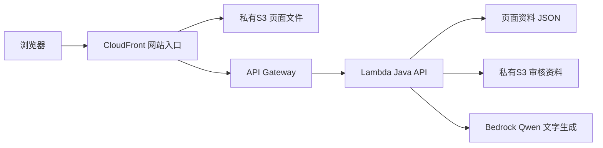
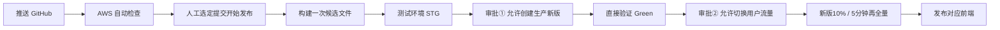

# 从本地网站到 AWS：逐步学习记录

更新：2026-11-17。面向会使用终端、Git和基本Web开发，但没有AWS经验的读者。目标是复现本仓库的功能、架构和发布流程；个人资料、账号、域名由你自己提供。

本手册基于已核对的生产26（源码 `f4b91d3`）。各章中的云端写操作需要先决定费用和范围；本轮只更新文档与网站内容，没有执行搭建命令。

## 选择起点

| 你的情况 | 从哪里开始 |
|---|---|
| 只想在电脑上看网站 | [01 本地运行](01-local.md)，无需AWS账号 |
| 新账号搭一套相同架构 | 按00→06顺序，每章验收后继续 |
| 已有这个网站的维护者 | [06 日常发布与排错](06-operations.md)，不要重建State、网站或流水线 |
| 查过去的真实执行与失败 | [执行日志](../history/aws-execution-log.md)；[旧手册归档](history-20261114.md)仅作历史复盘 |

| 顺序 | 操作 | 完成结果 |
|---|---|---|
| 00 | [账号、SSO、工具](00-start.md) | 本机使用临时凭证访问自己的AWS账号 |
| 01 | [本地网站与Lambda包](01-local.md) | 可运行的网站、经过校验的首次部署文件 |
| 02 | [State、首次部署、域名](02-first-site.md) | HTTPS网站和Java API |
| 03 | [CI/CD与两道审批](03-delivery.md) | 从GitHub提交到前后端发布 |
| 04 | [费用关停](04-cost-control.md) | 可查询、暂停和恢复本项目 |
| 05 | [有边界的AI问答](05-ai.md) | 私有资料→Java→Bedrock→回答 |
| 06 | [日常发布与排错](06-operations.md) | 能发版、查日志、判断恢复方式 |
| 07 | [Codex harness 与 Superpowers](07-ai-workflow.md) | 分清模型与工作流，安装核实、执行一个小重构并留下验证证据 |
| 08 | [离线问答评估](08-offline-qa-eval.md) | 用合成样本与假模型回归Java契约，读取报告并验证失败门槛 |
| 09 | [本地审阅STG问答证据](09-staging-evidence.md) | 核对报告身份、覆盖及已记录usage，区分一致性、真实性和审批 |
| 10 | [采样计划与预算](10-sampling-plan.md) | 固定调用数与token假设，核实价格、生成不可执行草案并说明费用边界 |
| 11 | [Node脚本迁移](11-script-relocation.md) | 保留CLI和导出，验证根路径与仓库外调用，防止扫描范围缩小 |

## 要搭什么

S3保存文件，CloudFront分发页面，API Gateway接收请求，Lambda按请求运行Java。DNS把域名指向CloudFront。没有数据库、常驻ECS容器或ALB；RAG知识库是备选，没有部署。

## 如何使用命令

命令使用PowerShell，从仓库根目录执行，除非另有说明。下文的Terraform **root**指一组独立管理的配置目录，例如 `infra/terraform/portfolio`，不是AWS根用户。

| 常见写法 | 作用 |
|---|---|
| `aws ... --profile kong-dev` | 用这份本机登录配置调用AWS；00章也会设置默认profile和东京区域 |
| `terraform -chdir=目录 ...` | 在指定配置目录操作，不用先切换终端目录 |
| `init` | 下载声明的Provider，并连接保存资源记录的backend；不会创建网站资源 |
| `validate` | 检查配置结构；不证明账号权限或线上功能正确 |
| `plan -var-file=输入.json -out=计划.tfplan` | 读取自己的参数，查询现状并保存待审核变更；尚未应用 |
| `show 计划.tfplan` | 查看刚保存的变更；`+`新增、`~`修改、`-`删除、`-/+`替换 |
| `apply 计划.tfplan` | 执行这份计划，会修改AWS；输入改变后需要重新plan和审核 |
| `output -raw 名称`／`-json 名称` | 读取已保存的部署输出，分别适合单个字符串／结构化数据 |
| `$Name`／`$env:NAME` | 当前终端变量／供子进程使用的环境变量；新终端需重新加载上下文 |

Provider是Terraform与AWS通信的组件；backend是State的保存位置。IAM策略写明“谁能对哪些资源做什么”，角色供Lambda或构建服务取得临时权限，ARN是资源的完整标识。后文的STG是独立测试环境，生产环境才接待访客。

各章给出目录、输入来源、命令作用、完成标准和对应控制台路径。`<...>`必须换成你的值。`#`开头是可一同复制的注释。

按步骤执行，前一步失败就停，不把整章盲目一次粘贴。原生命令结束后可用 `$LASTEXITCODE`检查：0通常成功，非0先查报错；Terraform `plan -detailed-exitcode`的2特指存在变更。PowerShell的 `$ErrorActionPreference='Stop'`不能替所有原生命令判断失败。计划失败时不执行旧计划文件，修正后重新plan、show、审核。

- **本地**：编辑、测试、打包，不调用AWS。
- **云端读取**：查身份、配置、日志或公开页面；部分读取也可能计费。
- **云端写入／付费**：`apply`、上传、构建、模型调用、停站、发布。审核范围后才执行，文档展示不代表已经执行。
- 本地通过、真实STG通过、生产成功、浏览器模拟和手机真机验证，是不同证据。

| 事情 | 推荐方式 | 鼠标能否代替 |
|---|---|---|
| 创建、更新本项目资源 | Terraform计划→审核→apply | 能手建类似资源，但不会自动进入本仓库State；本路线不混用两种创建方式 |
| 登录、GitHub授权、人工审批 | 浏览器 | 可以，也是需要人处理的步骤 |
| 查日志、版本、告警 | CLI或控制台 | 可以，各章列出路径 |
| 固定某个提交开始发布 | CLI指定完整SHA | 控制台能选择源版本时可以；“重试／发布最新”不等于固定提交 |
| 改应用并上线 | Git＋AWS流水线 | 不用手传Lambda ZIP或改S3代替，否则绕过候选和审批 |

## 不要照搬的值

新读者使用自己的账号、SSO、GitHub仓库／用户ID、域名和通知邮箱。版本号、release ID、S3 VersionId和校验值从本次输出取得。

代码保留 `kongportfolio-prod`、`kongportfolio-stg` 等项目名称；在不同账号可同名，同账号重复搭建会冲突。GitHub仓库和部分脚本默认账号要按章节调整。私有变量、State、计划、审核资料不在Git里，缺失时不能猜值。

新命令已按当前脚本、变量和路径核对并做静态检查；没有在新AWS账号执行整套付费搭建。真实运行证据见[生产26记录](../history/releases/bedrock-staging-language-fix.md)。
