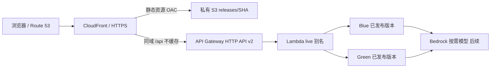

# 当前 AWS 路线 — Lambda + HTTP API

2026-11-11 用户选择，替代原 ECS/ALB 常驻方案。React、Java 21 / Spring Boot 保留，无数据库。Terraform 管基础设施，CI/CD 全部在 AWS。架构已选定不等于所有付费资源已获创建批准。

S3 Block Public Access + REST origin/OAC；不使用 website endpoint。CloudFront viewer HTTPS、证书在 us-east-1。API 转发所需 query/headers，Host 使用 HTTP API origin 域名；不缓存 API。SPA 路由只重写页面请求，不能把 API 错误和缺失资源改成 HTML。API Gateway 仅获调用指定函数别名的权限；Lambda 角色只给日志与后续必要 Bedrock 模型权限。设置 API 节流和 Lambda 并发上限；它们不等于月费硬上限。

## 小 Story 顺序

| Story | 验收 / 状态 |
|---|---|
| S2-01 State | 已创建 S3 State，迁移和并发锁已验证 |
| S2-02 预检 | 已核对现有 Budget/zone；未改 DNS |
| S2-03 Lambda 适配 | 本地 HTTP、HTTP API v2 事件、独立 ZIP 冒烟；本轮交付 |
| S2-04 首次部署 | [已获批准并上线](../infra/terraform/portfolio/DEPLOYMENT.md)，23 新增；health 修复后 live=2，HTTPS 验收和 No changes 通过；视觉检查未完成 |
| S2-04D 自定义域名 | [konglingtong44.com 已上线](custom-domain.md)，注册/委派/免费证书/HTTPS 验收完成；原 testec2 保留，No changes |
| S2-05 AWS CI/CD | CodeConnections/CodeBuild/CodePipeline；固定 SHA、扫描、测试、构建一次，产物复用 |
| S2-06 蓝绿 | Lambda CodeDeploy 版本切流、两次审批、验证、告警和回滚；前端 CloudFront 蓝绿另一个增量 |
| S2-07 Bedrock | 后端角色调用、限定公开资料、输入/输出上限、节流、成本观测；不放浏览器密钥 |

## CI/CD 与蓝绿目标（尚未实现）

CodeBuild PR CI 无生产权限；受信 release 构建固定 SHA，生成 ZIP/静态包和 SHA256 manifest。短期 STG 函数验证同一 ZIP，然后审批①；通过后才发布 PROD Green 的数字版本并直接调用该版本验证。审批②通过后才让 CodeDeploy 修改 `live` 别名，按灰度策略切流；失败由告警/部署测试回滚。

API Gateway 集成指向 `live`，不能指向 `$LATEST`。Terraform 管函数、权限、别名初始值及部署组；正常发布由流水线/CodeDeploy 管版本和别名权重，实施时明确所有权，避免下一次 terraform apply 覆盖线上切流结果。发布排队，审批绑定 execution/SHA/版本/hash，旧审批不得切换新产物。保留上一个稳定版本和对应产物。

前端不可变 `releases/<SHA>/` 及独立发布 manifest；前后端 API 向后兼容。CloudFront Continuous Deployment 配置、测试 header、审批和共享配置锁在前端蓝绿 Story 实作，不能把两个 S3 目录直接当成蓝绿。

## 成本目标

按每月 1,000 次访问、3,000–5,000 普通 API、另 1,000 次短问答、约 20 次少量构建发布，预算目标 USD 2–5/月；不含域名续费/税费，非账单上限，实际取决于免费额度共享、执行时间/构建时间、tokens 和流量。现有 USD 10 Budget 只提供提醒。

东京 Nova Micro 当前价格示例：输入 USD 0.042/百万 tokens、输出 USD 0.168/百万 tokens；每次总输入 1,000 / 输出 500 tokens，1,000 次约 USD 0.126。模型地区/账号可用性及回答质量待验证，不承诺任意模型都在该预算内。[官方东京价格表](https://pricing.us-east-1.amazonaws.com/offers/v1.0/aws/AmazonBedrock/current/ap-northeast-1/index.json)

初期不设预置并发或专用模型吞吐，接受冷启动；不引入 ALB、NAT、常驻服务器或向量数据库。日志短期保留、产物按回滚窗口清理；构建时间和免费额度在首次实际运行后复核。[Lambda](https://aws.amazon.com/lambda/pricing/)、[HTTP API](https://aws.amazon.com/api-gateway/pricing/)、[CodeBuild](https://aws.amazon.com/codebuild/pricing/)、[CodePipeline](https://aws.amazon.com/codepipeline/pricing/)
